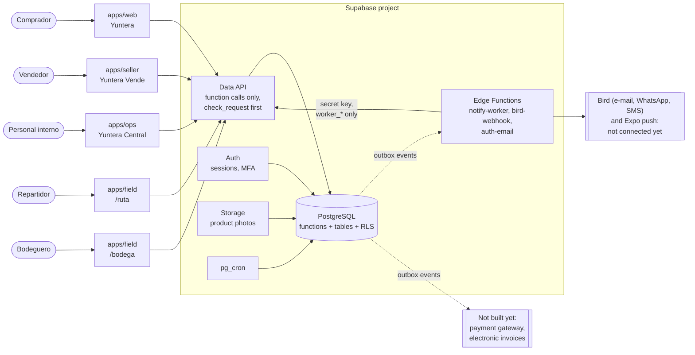

# Architecture overview

Yuntera is one PostgreSQL database with a small, named set of functions in
front of it, and a handful of thin web apps that call those functions. There
are no microservices, no message broker and no separate back-end service. This
document explains how the pieces fit, why it was built this way for a solo
founder who is still validating the business, and what would have to be true
before any part is split out.

**Verification status, stated once and plainly.** Everything described as
_built_ here was run against a local PostgreSQL 16 and a local stand-in for the
Supabase API (`tools/dev-api`). Nothing has yet been run against a real
Supabase project or deployed anywhere. The first deployment is itself a test;
see [`07-deployment/runbook-first-deploy.md`](../07-deployment/runbook-first-deploy.md).

## System context



| App                                            | Who uses it                                       | State                                                                              | Notes                                                                                                                                                        |
| ---------------------------------------------- | ------------------------------------------------- | ---------------------------------------------------------------------------------- | ------------------------------------------------------------------------------------------------------------------------------------------------------------ |
| `apps/web` — Yuntera                           | Shoppers                                          | Built; full purchase journey verified in a real browser against the local stand-in | Next.js 16, Spanish only                                                                                                                                     |
| `apps/seller` — Yuntera Vende                  | Sellers and their staff                           | Built against the same local stand-in; see `STATUS.md` for how far it was verified | Next.js                                                                                                                                                      |
| `apps/ops` — Yuntera Central                   | Internal staff                                    | In progress                                                                        | Next.js, deployed on its own origin so a flaw in a public app cannot reach the console's session                                                             |
| `apps/field` — Yuntera Ruta and Yuntera Bodega | Drivers (`/ruta`) and warehouse staff (`/bodega`) | Planned; the functions it calls exist and are tested                               | One installable mobile web app. Native apps are deferred; see [decision 4](decisions.md#4-one-mobile-web-app-for-drivers-and-warehouse-native-apps-deferred) |

App names, audiences and planned hostnames are defined once in
`packages/brand/src/brand.ts`.

## Why a modular monolith on Postgres

The team is one person and the business is unproven. The architecture is
chosen to minimise the number of things that can break at 2 a.m. and the number
of things that must be learned before the first order.

- **One transactional store.** An order, its stock reservations, its shipments
  and its payment record are created in a single database transaction
  (`public.place_order`). There is no distributed transaction to get wrong.
- **Rules live next to the data.** Stock cannot be oversold because a `CHECK`
  constraint forbids it; a ledger transaction cannot be unbalanced because a
  deferred constraint trigger refuses the commit. These hold no matter which
  app, script or person makes the change.
- **A managed platform does the undifferentiated work.** Supabase provides the
  database, sign-in, the HTTP API in front of the functions, scheduled jobs and
  backups. Vercel hosts the web apps. The founder operates neither.
- **Modules, not services.** The code is separated by domain — identity,
  geography, catalogue, inventory, orders, logistics, finance, trust — in both
  the migrations and `packages/core`. A module can become a service later; a
  premature service cannot easily become a module again.

The cost of this choice is real and accepted: business logic in SQL is harder
to unit-test and to hire for than application code, and the database is a
single point of failure. The first is mitigated by the test layers in
[`repository.md`](repository.md#test-layers); the second by the managed
platform's backups and by keeping the door open to a split (see
[Scaling path](#scaling-path)).

## The API is the set of database functions

Clients never read or write tables directly to build a screen. They call
functions: one function returns one screen's whole payload as JSON, and one
function performs one business action. Since the security review of
21 November 2026 they cannot do otherwise: signed-in users and visitors hold
no privilege on any table, view or sequence. This is recorded as
[decision 1](decisions.md#1-database-functions-are-the-public-api).

```mermaid
sequenceDiagram
  participant B as Browser
  participant N as Next.js server (apps/web)
  participant A as Data API
  participant P as PostgreSQL

  Note over B,P: A read — the product page
  B->>N: GET /p/audifonos-inalambricos-nimbo-aire
  N-->>B: Prerendered shell (static HTML)
  N->>A: rpc get_product(slug, postal_code) — publishable key, no user
  A->>P: runs as role anon
  P-->>A: one JSON document (RLS already applied)
  A-->>N: JSON
  N-->>B: Streams the product into the shell; result cached and tagged

  Note over B,P: A write — placing an order
  B->>N: Server Action placeOrder(form)
  N->>N: Reads the session cookie, verifies the token signature
  N->>A: rpc place_order(items, address, method, idempotency key) — user's token
  A->>P: runs as role authenticated, auth.uid() = the shopper
  P->>P: Re-prices from its own data, reserves stock, writes order,<br/>shipments, payment, outbox event — one transaction
  P-->>A: { order_number, status, total }
  A-->>N: JSON, or an error code such as insufficient_stock
  N-->>B: Redirect to /pedidos/YT-…, or the message for that code
```

Three properties follow.

1. **Nothing the client says about money is trusted.** Prices, tax, shipping
   and totals are recomputed in the database from its own rows
   (`private.price_items`, `private.shipping_for`). The client sends offer ids
   and quantities, plus the total it showed the shopper; if the two totals
   differ the order is refused with `price_changed` instead of charging a
   different amount.
2. **Errors are a contract.** Functions raise stable machine-readable codes
   through `private.fail('code')`. `packages/db/src/errors.ts` maps every code
   to a message in Spanish and English, and a test fails if a code is raised
   without a message or a message exists for a code nothing raises.
3. **The apps hold no privileged key.** Each app has only the project's
   publishable key. What a caller may do is decided in the database: the API
   roles may execute functions and touch no table, view or sequence directly;
   each function checks its caller; row-level security is the second lock. See
   [`03-data/access-control.md`](../03-data/access-control.md).

`packages/db` is the typed client: `createApi(transport)` exposes one method
per function, and every response is validated against a schema
(`packages/db/src/schemas.ts`) so a drifted payload fails loudly at the edge
instead of rendering wrong.

### Before every request, and outside the Data API

The Data API runs `public.check_request()` before every call
(`pgrst.db_pre_request`). It refuses a deleted account, an ended session and a
password-only session of an account with a second factor, so ending a session
takes effect at once. Storage and Realtime do not run it; the storage rules
call the same helpers (`private.session_alive`, `private.factor_ok`).

Server-side work that has no user, so far only notifications, runs outside the
apps as Edge Functions with their own secret key, which reaches only the
`worker_*` functions. The flow is described in
[notifications](../06-operations/notifications.md); the stand-in for local work
is `tools/dev-notify` (a host for the same handlers and fake providers),
started by `tools/dev/stack.sh up`.

Product photos are files in Supabase Storage: a private bucket for what
sellers upload and a public one for approved photos, decided by rules on
`storage.objects`. The console publishes a photo by re-encoding it on its own
server (`sharp`) under the staff member's session.

## Caching model

The storefront uses Next.js 16 with Cache Components (partial prerendering).
Each page is a static shell that is served immediately, with holes that are
filled as data arrives.

| Kind of content                                                               | Where it is read                                              | Lifetime                                                                                      | Invalidated by                                                                                                                                                           |
| ----------------------------------------------------------------------------- | ------------------------------------------------------------- | --------------------------------------------------------------------------------------------- | ------------------------------------------------------------------------------------------------------------------------------------------------------------------------ |
| Categories                                                                    | `getCategories` in `apps/web/src/lib/data.ts`                 | `hours` profile                                                                               | Tag `categories`                                                                                                                                                         |
| Districts and zones                                                           | `getDistricts`                                                | `days` profile                                                                                | Tag `districts`                                                                                                                                                          |
| Search results, category pages, home shelves                                  | `searchCatalog`                                               | `minutes` profile: served stale for up to 5 minutes, refreshed in the background every minute | Tag `catalog`, dropped only by the protected refresh endpoint                                                                                                            |
| Product page                                                                  | `getProductPage`                                              | `minutes` profile                                                                             | Tags `catalog`, `product:<slug>` and `offer:<id>` per offer: an order drops its offers' pages, a cancellation or a review its products' pages, never the whole catalogue |
| Search suggestions                                                            | `getSuggestions`                                              | `minutes` profile                                                                             | Tags `catalog` and `suggestions`                                                                                                                                         |
| Anything about the signed-in person: account, cart contents, orders, checkout | Read per request inside a `<Suspense>` boundary, never cached | —                                                                                             | —                                                                                                                                                                        |

The whole `catalog` tag is dropped only through the shop's refresh endpoint,
which asks for `SHOP_REFRESH_KEY`: by the console when content is taken down,
a shop is suspended or closed, or a listing is rejected or an edit approved,
and by the seller centre when a listing is archived. An action any shopper
can repeat drops only the pages it changed (`packages/next-kit/src/cache-tags.ts`).

Two rules keep this safe.

- **Shared caches hold only public data.** Cached reads go through
  `publicApi()`, a client with no cookies and no user. Per-person reads go
  through `sessionApi()`, which reads the request and therefore can never be
  placed in a shared cache.
- **A stale price is harmless because checkout does not believe it.** A shopper
  may briefly see a price or an "in stock" that changed a minute ago. The
  database re-prices and re-checks stock when the order is placed and refuses
  with a clear message if they differ.

The Content-Security-Policy that goes with this model is static and allows
inline scripts; that is a deliberate trade-off recorded as
[decision 7](decisions.md#7-a-static-content-security-policy-with-unsafe-inline-scripts).

## Where each kind of logic lives

| Kind of logic                                                                                                                                                               | Lives in                                                  | Why there                                                                          |
| --------------------------------------------------------------------------------------------------------------------------------------------------------------------------- | --------------------------------------------------------- | ---------------------------------------------------------------------------------- |
| Invariants that must hold for every writer: stock never negative, ledger balanced, legal status transitions, totals add up                                                  | SQL constraints and triggers                              | They cannot be bypassed by a buggy client or a manual fix                          |
| Multi-step business actions: place an order, capture a payment, pick, pack, deliver, settle cash                                                                            | SQL functions (`security definer`, caller checked inside) | They must be atomic and must not trust the caller                                  |
| Who may see which row                                                                                                                                                       | Row-level security policies                               | The second lock under the functions                                                |
| Screen payloads                                                                                                                                                             | SQL functions returning JSON                              | One round trip per screen; tables can change without breaking apps                 |
| Algorithms that are easier to reason about and test as code: fees, featured offer, search ranking, delivery promise, sourcing, routing, risk, seller score, recommendations | `packages/core` (pure TypeScript, no I/O)                 | Fast unit tests; shared by every app; the specification the SQL is checked against |
| Costa Rican rules: cédula and phone formats, postal codes, Plus Codes, consumer-law periods, Hacienda codes                                                                 | `packages/core/src/cr/`                                   | One place to correct when a rule changes                                           |
| Presentation, form handling, session cookies, cache lifetimes                                                                                                               | The apps                                                  | They are the only part that knows about HTTP and HTML                              |
| Brand: name, colours, type, logo                                                                                                                                            | `packages/brand`                                          | Renaming the product is an edit to one file                                        |

Some logic exists twice on purpose — in TypeScript as the readable, heavily
tested specification, and in SQL because money and stock must be decided
inside the transaction. The next section is what keeps the two from drifting.

**What is specified in `packages/core` but not yet wired into a running flow.**
This matters when reading the algorithm documents:

| Module               | State                                                                                                                                                                  |
| -------------------- | ---------------------------------------------------------------------------------------------------------------------------------------------------------------------- |
| `fees.ts`            | Mirrored in SQL (`private.compute_seller_fees`) and run on every captured payment                                                                                      |
| `search.ts`          | Mirrored in SQL (`public.search_products`) and used by the storefront                                                                                                  |
| `promise.ts`         | Mirrored in SQL (`private.compute_promise`) and used at quote and checkout                                                                                             |
| `lifecycle.ts`       | Mirrored in SQL transition triggers                                                                                                                                    |
| `offers.ts`          | Run by the storefront's product page on the offers the database returns; listings use a simpler SQL rule (cheapest buyable new offer)                                  |
| `routing.ts`         | Intended to run in the ops console before `ops_create_route`; the console is in progress                                                                               |
| `allocation.ts`      | Specification only. `place_order` uses a simpler rule: each line ships from one location that has all its units                                                        |
| `risk.ts`            | Specification only. The `orders.risk_score` and `risk_decision` columns exist but nothing fills them; the live controls are the cash-on-delivery limit and zone switch |
| `sellers.ts`         | Specification only. `sellers.score` is a column with a default of 90; no job recomputes it                                                                             |
| `recommendations.ts` | Specification only. `product_relations` exists and the product page reads it, but no job writes to it; the page falls back to products from the same category          |

## Parity tests

| What must agree                                                                   | Checked by                                | How                                                                                                     |
| --------------------------------------------------------------------------------- | ----------------------------------------- | ------------------------------------------------------------------------------------------------------- |
| Order and shipment transitions in `lifecycle.ts` and in the database triggers     | `packages/core/src/cr/compliance.test.ts` | Reads the migration between `-- BEGIN/END order_transitions` markers and compares the tables            |
| Order and shipment status enums, in the same order                                | Same test                                 | Parses `create type` from the foundation migration                                                      |
| Fee schedule: payment fees, fulfilment tiers, defaults, version                   | Same test                                 | Parses the `insert into public.fee_*` rows in the finance migration                                     |
| Search constants: text-relevance tiers, quality weights, exponent, typo threshold | Same test                                 | Parses the search migration                                                                             |
| Fee arithmetic, to the céntimo                                                    | `supabase/tests/040_money.sql`            | Replays the cases from `fees.test.ts` through real orders and compares every fee line                   |
| Delivery promise dates                                                            | `supabase/tests/010_promise.sql`          | Same scenarios as `promise.test.ts`                                                                     |
| Error codes raised in SQL and messages in the client                              | `packages/db/src/errors.test.ts`          | Reads every `private.fail('…')` in the migrations                                                       |
| Payload shapes returned by functions and the client's schemas                     | `packages/db/src/contract.test.ts`        | Calls the real functions as each role and validates the responses; runs only when `DATABASE_URL` is set |

## Scaling path

Do nothing until a trigger is measured. Each row names the symptom, not a date.

| Trigger, measured                                                                                                          | Change                                                                                                     | What it costs                                                          |
| -------------------------------------------------------------------------------------------------------------------------- | ---------------------------------------------------------------------------------------------------------- | ---------------------------------------------------------------------- |
| Database CPU sustained above about 60%, or p95 of `search_products` above about 300 ms                                     | Larger compute size on the same project                                                                    | Money only; no code                                                    |
| Catalogue reads dominate load after the step above                                                                         | A read replica for `search_products` and `get_product`; the cached storefront already absorbs most of this | A second connection target for `publicApi()`                           |
| Search relevance or latency is the measured bottleneck, or the catalogue passes roughly a hundred thousand active products | A dedicated search engine fed from the outbox                                                              | A new service and an indexing pipeline; ranking constants move with it |
| Work that must not run inside a request appears: payment webhooks, e-mail, electronic invoices, gateway refunds            | A worker that drains `private.outbox_events` (an Edge Function on a schedule is enough to start)           | First server-side code holding a secret; needs its own monitoring      |
| More than a few dozen stops per driver, time windows, or several depots                                                    | Replace `planRoutes` behind the same function signature with a solver or a routing API                     | A paid API or a service to run                                         |
| Outbox backlog grows, or several consumers need the same events                                                            | A real queue                                                                                               | Operational weight; only then                                          |
| A second team owns a domain, or a domain needs a different release cadence                                                 | Extract that module behind its existing function names                                                     | The first true service boundary                                        |
| Reporting queries slow down operations                                                                                     | Replicate to an analytics store                                                                            | A pipeline to maintain                                                 |

The numbers in the first three rows are starting points to tune, not
measurements; nothing has been load-tested.

What is deliberately not on this path until a row above fires: microservices,
Kubernetes, a message broker, a data warehouse. They are listed in the
roadmap's ["do not build yet"](../01-product/roadmap.md#do-not-build-yet) table.

## Known gaps

These are not built. They are listed here so that no reader assumes otherwise.

- **No payment gateway.** `payments_mode` is `sandbox`; `confirm_sandbox_payment`
  simulates a payment and refuses to run in `live` mode. Outside sandbox, the
  only way to mark a transfer as received is by hand: finance staff call
  `ops_confirm_payment` with the bank's reference. A real gateway needs a
  server-side webhook handler that calls `private.capture_payment`.
- **Refunds are booked, not paid.** Cancellations, returns and parcels that
  come back post to the ledger and to one refund register
  ([decision 26](decisions.md#26-one-register-for-every-refund)), which
  refuses to refund the same thing twice or more than was paid; nothing sends
  money back to a shopper.
- **One consumer for the outbox, and it sends nothing real yet.** The
  notification worker (`packages/notifications`, run as Edge Functions under
  `supabase/functions`) plans and sends messages, but no provider account is
  connected: locally it talks to the fakes in `tools/dev-notify`. No
  electronic invoice is issued.
- **Uploads are product photos only.** Proof-of-delivery photos and photos
  from the phone apps are not built, and nothing deletes unused photo files on
  a schedule.
- **No limit per minute outside sign-in, nor on request size.** The database
  limits what each account may have open and bounds every input
  ([decision 27](decisions.md#27-limits-are-per-account-and-per-target-never-per-address)).
  Sign-in, sign-up, account e-mails, codes and token refreshes have the apps'
  own limit per visitor and per account
  ([decision 30](decisions.md#30-the-web-apps-own-sign-in-limit-per-visitor-and-per-account)),
  because Auth's limits see the apps' server, not the visitor. Search,
  checkout and the rest have no limit per minute beyond the platforms'
  defaults.
- **No English interface.** The schema and error messages carry English; the
  apps render Spanish only.
- **Not run on real Supabase.** See the status note at the top.
