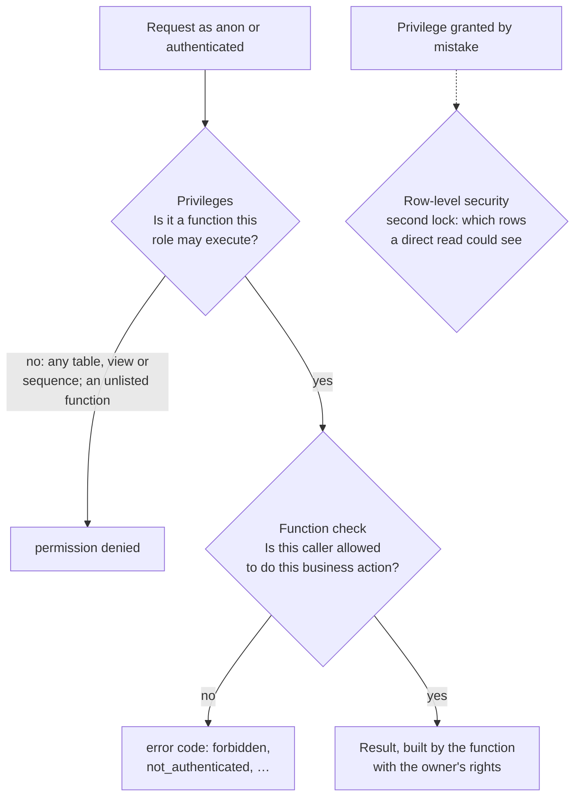

# Access control

Who can reach what, and how that is enforced. The short version: every request
arrives at the database as one of two unprivileged roles, with the signed-in
user's identity attached; those roles can touch **no table, view or sequence
at all**, only execute functions; each function checks its caller; row-level
security sits underneath as a second lock; and no app holds a key that skips
any of it.

Source: `supabase/migrations/20261121082800_lockdown.sql` for privileges and
the current policies (it supersedes the grants of `…081400_access_control.sql`),
`…080100_identity.sql` for the role helpers, and the checks inside each
function. Tested by `supabase/tests/020_access.sql` (each kind of user, through
the functions they call), `070_api.sql` (each screen function, right and wrong
caller) and `110_lockdown.sql` (a guard over the whole catalogue, plus every
finding of the November 2026 security review replayed), all of which run as
real API roles with real claims.

## The roles a request can have

| Postgres role   | Who it is                                                                   | How a request gets it                                                     |
| --------------- | --------------------------------------------------------------------------- | ------------------------------------------------------------------------- |
| `anon`          | A visitor who is not signed in                                              | The publishable key alone                                                 |
| `authenticated` | Any signed-in person: shopper, seller, driver, warehouse associate or staff | The publishable key plus the user's session token                         |
| `service_role`  | Bypasses row-level security                                                 | A secret key. **No app has one.** Reserved for future server-side workers |

Everything a signed-in person is beyond "a shopper" comes from rows, not from
the token:

| They are…                       | Because of a row in…            | Checked by                                                            |
| ------------------------------- | ------------------------------- | --------------------------------------------------------------------- |
| Internal staff, with a role     | `staff_members` (`active`)      | `private.is_staff()`, `private.has_staff_role(…)`                     |
| A member of a seller account    | `seller_members`                | `private.is_seller_member(seller)`, `private.is_seller_admin(seller)` |
| A warehouse associate at a site | `warehouse_staff`               | `private.works_at(warehouse)`                                         |
| An active driver                | `drivers` (`status = 'active'`) | `private.my_driver_id()`, `private.drives_route(route)`               |

Because these are looked up on every request, removing the row removes the
access immediately. A token that is still valid for an hour does not keep a
dismissed employee in the console.

**Staff and a second factor.** `private.staff_session_ok()` is part of every
staff check. When the setting `require_staff_mfa` is true, it requires the
session token's `aal` claim to be `aal2` — that is, the person completed
multi-factor sign-in for this session. With the setting on, a staff member who
signed in with a password alone has exactly a shopper's access. The setting
ships as `false` and must be turned on before launch.

## Three layers



### 1. Privileges: the functions are the only door

On Supabase, every table, view and sequence that `anon` or `authenticated`
holds any privilege on is reachable over HTTP (`/rest/v1/<table>`), whether or
not an app uses it. The security review of 21 November 2026 found most of its
holes there: column grants that let a seller attach an offer to a competitor's
listing or set a listing's tax rate, support staff re-open a refunded return,
any staff role read every delivery code. So the rule is now absolute:

- **Tables, views, sequences: nothing.** `anon`, `authenticated` and PUBLIC
  hold no privilege — no `select`, `insert`, `update` or `delete`, no column
  privilege, no sequence `usage` — on anything in `public` or `private`. The
  lockdown migration revokes them by sweeping the catalogue rather than naming
  tables, so it also covers tables added by migrations that ran before it.
- **Nothing granted by default.** The default privileges of `postgres` (the
  role the migrations run as) give the API roles and PUBLIC nothing on new
  tables, sequences or functions in `public` or `private`, and PUBLIC nothing
  on new functions anywhere. A hosted Supabase project ships with defaults
  that grant `anon`, `authenticated` and `service_role` everything new in
  `public`; the local shim copies that, and the migrations switch the API
  roles' part off on both. `service_role`'s defaults are the platform's and
  are left alone; no app holds that key.
- **Functions: a named list.** Every function in `public` runs with its
  owner's rights (`security definer`) and `search_path = ''`, and checks its
  caller first. Visitors may execute only the functions listed
  [below](#what-each-role-may-execute). Signed-in users may execute every
  function in `public` except the internal ones listed there. PUBLIC may
  execute nothing in `public` or `private`.

`110_lockdown.sql` fails when any of this stops being true: a privilege on a
table, view or sequence; a function in `public` that is not owner's-rights
with an empty search path; a function executable by a role the list does not
name; a table without row-level security; a policy that reads another table
directly; a default that would grant new objects. It is what keeps the door
closed when later migrations are merged.

A consequence: **a legitimate action exists only if a function does it.**
Some writes that used to be possible directly have no function yet: editing a
shop's name, description, logo or fiscal details; managing a shop's members;
withdrawing a consent; moderating a review; editing categories, brands,
synonyms, fees, delivery zones or the calendar; changing a listing's photos or
switching a variant off. None of them was used by an app; each needs a
function before it can be done again through the API.

Supabase's own guidance is the same model — privileges decide whether a role
can touch an object at all, policies decide which rows — and the platform is
moving its defaults toward revoking automatic grants. The migrations do not
depend on which default a project has: they revoke either way.

### 2. Function checks

A `security definer` function runs with its owner's rights, so row-level
security does not constrain it; the function is responsible for checking the
caller. Every one of them does, in its first lines, and refuses with a stable
error code (`not_authenticated`, `forbidden`, or a "not found" that does not
reveal whether the thing exists).

The browsing functions (`search_products`, `get_product`, `cart_lines`,
`list_categories`, `my_orders` and the like) used to run with the caller's
rights and let the policies filter what they read. They now run with the
owner's rights and write the same visibility rules into their own `where`
clauses: active listings in active categories for everyone, plus drafts and
switched-off categories for staff, and a seller's own listings for that
seller. Their results did not change.

### 3. Row-level security: the second lock

Enabled on every table in `public` and `private`. No API role can read a
table directly any more, so the policies no longer decide what a screen shows;
they are there so that a privilege granted by mistake still exposes only the
rows its policy allows. Only **read** policies remain: the write policies went
with the write privileges, so even a mistaken `insert`, `update` or `delete`
grant is refused by row-level security. Two read policies were narrowed after
the review: customer profiles are readable by support (not every staff role),
and driver records by ops (not support).

Policy style, which matters for both correctness and speed:

- Role checks are wrapped in a sub-select — `(select private.is_staff())` — so
  Postgres evaluates them once per statement, not once per row.
- **A policy never reads another table directly.** It asks an owner's-rights
  helper in `private` (`private.can_see_order(order_id)`,
  `private.can_see_product(product_id)`, …). A policy that read
  `public.orders` itself would fail for lack of a privilege, and would recurse
  into that table's own policies. This holds for policies in any schema,
  including those on storage objects; the guard test checks it.
- In a sub-query inside a policy, **every reference to the outer table's column
  is qualified with the table name.** The reason is the bug described
  [below](#a-real-bug-and-what-it-taught).

## What each kind of user can do

A summary; the migration is authoritative.

### Visitor (`anon`)

| Can                                                                           | Cannot                                                                        |
| ----------------------------------------------------------------------------- | ----------------------------------------------------------------------------- |
| Search and browse active products from active sellers; read published reviews | See drafts, rejected listings, or anything from a pending or suspended seller |
| Read categories, districts, zones, holidays, the fee schedule                 | Read any profile, address, order, stock level or seller's private details     |
| Get a delivery estimate and a checkout quote                                  | Place an order                                                                |
| Report a listing, review or seller, giving an e-mail address                  | Read the report queue                                                         |

### Shopper (any signed-in user)

| Can                                                                                   | Cannot                                                                                    |
| ------------------------------------------------------------------------------------- | ----------------------------------------------------------------------------------------- |
| Read and edit their own profile (name, phone, locale, marketing choice)               | Mark their own phone as verified                                                          |
| Add, edit and soft-delete their own addresses                                         | See anyone else's                                                                         |
| Place, pay (in sandbox), cancel and read their own orders, including the delivery PIN | Read another person's order — it answers "not found", the same as one that does not exist |
| Review a product they received; request a return; file a complaint                    | Review something they did not buy, or twice                                               |
| Record their own consents                                                             | Back-date a consent, or withdraw one (no function for that yet)                           |

### Seller member

| Can                                                                                                                 | Cannot                                                                                                                                                                    |
| ------------------------------------------------------------------------------------------------------------------- | ------------------------------------------------------------------------------------------------------------------------------------------------------------------------- |
| Read their seller's private details, members, listings, offers, stock, statements and payouts                       | Read another seller's                                                                                                                                                     |
| Create listings as draft or pending review; edit their content; set price, handling time and status of their offers | Publish a listing; change a published listing except through a reviewed edit; write ranking, rating or summary columns                                                    |
| See the order lines they sold and each line's progress, with the shopper's first name, district and cantón          | See the shopper's full name, phone, e-mail, address or map pin — Yuntera delivers, so the seller never needs them                                                         |
| Set stock at their own location; announce stock sent to a warehouse; mark their own parcels packed                  | Change stock held in a Yuntera warehouse                                                                                                                                  |
| Reply to a review of their product                                                                                  | Remove or edit a review                                                                                                                                                   |
| Admins and owners: request a change of payout account (finance approves it)                                         | Change the payout account or contact phone and e-mail; read an account number in full; edit the shop front, its fiscal details or its members (no function for those yet) |

### Warehouse associate

| Can                                                                                                   | Cannot                                                      |
| ----------------------------------------------------------------------------------------------------- | ----------------------------------------------------------- |
| At the sites they are assigned to: see the floor board, pick lists, bins, stock and inbound shipments | See other sites                                             |
| Receive, put away, pick, pack, adjust stock with a note                                               | See shoppers' addresses or phones, prices paid, or payments |

### Driver

| Can                                                                                                                         | Cannot                                                                                  |
| --------------------------------------------------------------------------------------------------------------------------- | --------------------------------------------------------------------------------------- |
| See routes assigned to them and, for each stop: recipient name, phone, _señas_, pin location, parcels, cash to collect      | See the delivery PIN, the order's contents or price, or any other order of that shopper |
| Start a route, arrive, complete a stop with the shopper's PIN, record a failed attempt with a reason, report their position | Read a route's stops more than 24 hours after it was completed                          |
| See their own cash settlements                                                                                              | See another driver's route or position                                                  |

### Staff

Admin implies every role below.

| Role      | Reach                                                                                                                                                                     |
| --------- | ------------------------------------------------------------------------------------------------------------------------------------------------------------------------- |
| `ops`     | Orders, sellers' private details, drivers, warehouses and staff assignments, zones and calendar, dispatch board, routes, settlements, returns; approve or suspend sellers |
| `support` | Orders and timelines, profiles, addresses, consents, sellers' private details, stock levels, returns, complaints, content reports; cancel an order for a shopper          |
| `finance` | Orders, fee schedule, seller statements, the ledger, settlements, invoices; decides sellers' bank-detail requests; previews, creates and settles payout runs              |
| `catalog` | All listings; approve or reject a listing or a listing edit; resolve content reports. Categories, brands, synonyms and review moderation have no function yet             |
| `admin`   | All of the above, plus staff membership and the audit log (settings have no function yet)                                                                                 |

Sensitive changes by staff — to staff membership, seller status and private
details, drivers, warehouse assignments, settings, fees, payouts — are written
to `private.audit_log` with the acting user, and that log cannot be altered.
A bank account number is never copied into it: only its last four digits.

Two rules about people and money are enforced below the functions, on the
tables themselves. The platform always keeps one active administrator: a
trigger on `staff_members` refuses the change that would remove the last one.
And nobody writes a seller's payout account or a payout directly: sellers ask
with `seller_request_payout_details`, finance decides with
`ops_decide_payout_details`, and `payouts`, `payout_runs` and
`payout_detail_requests` have no grant to any API role at all. The full account
number is readable only through two finance functions (a request awaiting a
decision, and a run's transfer list). Finance confirms a change by calling the
shop's phone on file, so sellers cannot change that phone or the contact e-mail
directly either, and a request made within 30 days of a change to them is
flagged. Nobody in finance decides a request they made, or one for a shop they
belong to.

## Rules for `security definer` functions

These functions are the most powerful code in the system. The rules they follow:

1. **`set search_path = ''`**, and every object schema-qualified
   (`public.orders`, `private.fail`, `extensions.gen_random_bytes`). Without
   this, a caller who can create objects in any schema on the search path could
   plant a function or table with the same name and have it run with the
   owner's rights.
2. **Identify the caller from the token, never from an argument.** Functions
   use `(select auth.uid())`. No function accepts a user id to act as.
3. **Check before reading.** The permission check comes before any query whose
   result could leak through an error message or timing.
4. **Lock what you will change.** Rows that will be updated are selected
   `for update` first, in a consistent order, so concurrent calls cannot both
   pass a check and then both write.
5. **Fail with a code.** `private.fail('code')` raises SQLSTATE `P0001` with a
   stable message the client maps to text. Internal messages never reach a
   user.
6. **Granted explicitly.** `EXECUTE` is revoked from `public` and granted only
   to the role that should call it.

The `private` schema is not exposed by the Data API at all (a hosted project
exposes `public` and `graphql_public` only). `anon` and `authenticated` have
`USAGE` on it only so that row-level-security policies can call the yes-or-no
helpers listed below. Everything else in `private` — its tables, the audit
log, the outbox, the functions that capture payments and post to the ledger —
is readable or executable by no API role.

## What each role may execute

This is the list `110_lockdown.sql` checks against; a unit test in
`packages/db` keeps the two equal. Adding a function to a list is a decision:
name it here and in the test, and say why in the pull request.

**Visitors (`anon`)** may execute only these functions in `public`:

<!-- BEGIN visitor functions -->

- `cart_lines`
- `checkout_quote`
- `delivery_estimate`
- `get_product`
- `list_categories`
- `list_districts`
- `report_content`
- `search_products`
- `shop_path_exists`
- `suggest_products`

<!-- END visitor functions -->

**Signed-in users (`authenticated`)** may execute every function in `public`
that is not a trigger function and not one of these internal ones, which no
API role may execute:

<!-- BEGIN internal functions -->

- `reviewer_display_name` (turns an account id into a display name; only
  `get_product` calls it)

<!-- END internal functions -->

**Policy helpers.** Both `anon` and `authenticated` may execute these
functions in `private`, which row-level-security policies call. Each answers
yes or no (or "which ids") about the caller's own relationship to a row, from
the token:

<!-- BEGIN policy helpers -->

- `can_see_inbound`
- `can_see_order`
- `can_see_product`
- `can_see_shipment`
- `drives_route`
- `has_staff_role`
- `is_seller_admin`
- `is_seller_member`
- `is_staff`
- `my_driver_id`
- `my_seller_ids`
- `my_warehouse_ids`
- `owns_order`
- `route_open_to_driver`
- `sells_order_item`
- `seller_is_active`
- `works_at`
- `works_at_location`

<!-- END policy helpers -->

**PUBLIC** may execute nothing in `public` or `private`. `service_role` is the
platform's own server-side role and is not managed here.

## Checklist: adding a function safely

Before the migration is merged, answer each of these in the pull request.

- [ ] **Who may call it?** Name the role or relationship. If the answer is
      "anyone signed in", say what stops them acting on someone else's data.
- [ ] **Owner's rights.** Every function is `security definer`; an invoker
      function can read nothing, because the API roles hold no table
      privilege. Then:
  - [ ] `set search_path = ''` and schema-qualify everything.
  - [ ] First statement checks the caller and fails with a code; a function
        visitors call writes its visibility rules into its `where` clause.
  - [ ] No argument can name another user to act as.
- [ ] **What does it return to the wrong caller?** "Not found" for things that
      belong to someone else; never a different error that confirms existence.
- [ ] **Does it return personal data?** List the fields and why each is needed
      by this audience. A seller does not need a shopper's phone; a driver does
      not need the order's contents.
- [ ] **Does it write?** Lock rows first; make it safe to call twice.
- [ ] **Grant.** `grant execute … to authenticated`, and never a privilege on
      a table, view or sequence. A function visitors must call also gets
      `anon`, and goes on [the list](#what-each-role-may-execute) and in
      `110_lockdown.sql`.
- [ ] **Errors.** Every `private.fail('code')` has a message (in an area file
      under `packages/db/src/areas/`). A unit test enforces this.
- [ ] **Client.** A method and a schema in an area file.
- [ ] **Tests.** A suite in `supabase/tests/`: one block proving the right
      caller gets the payload, and one proving each wrong caller is refused or
      gets nothing. A contract test: the response matches the schema.

Adding a table has a shorter list: enable row-level security, grant the API
roles **nothing** (`110_lockdown.sql` fails otherwise), write a read policy
whose checks on other tables go through helpers in `private`, qualify outer
columns, and reach the table only through functions.

## A real bug, and what it taught

During testing, a driver signed in and saw an empty route: stops but no
parcels. The policy on `shipments` was meant to say "a driver sees the parcels
on stops they can see":

```sql
-- As first written. Wrong.
or exists (select 1 from public.route_stops rs where rs.shipment_id = id)
```

Inside the sub-query, the bare `id` does not mean `shipments.id`. Postgres
resolves an unqualified name against the innermost table first, and
`route_stops` has its own `id`. The condition was silently comparing a stop's
`shipment_id` to that same stop's `id` — never true. No error, no warning: the
policy simply matched nothing.

```sql
-- As it is now.
or exists (select 1 from public.route_stops rs where rs.shipment_id = shipments.id)
```

This one failed closed: the driver saw too little. The same mistake with the
logic the other way round would fail open and show too much, just as silently.

What changed as a result:

- Every policy sub-query was rewritten to qualify outer columns with the table
  name, and the rule is in the checklist above.
- The access tests gained **positive** cases. The suite had proved that a
  driver could not see other people's parcels; it had not proved that a driver
  could see their own. A test that only checks refusals passes when everything
  is refused.

The general lesson for this codebase: a row-level-security mistake does not
raise an error. The only defence is a test, per role, for both what must be
visible and what must not.

## What is not in place yet

- **Rate limiting.** Nothing limits sign-in attempts or function calls beyond
  the platform's defaults. The PIN check is the one place with its own counter.
- **Row-level security is enabled, not forced.** Table owners acting directly
  in the database are not subject to it. API roles are, which is what matters
  for requests; it means SQL run by an administrator in the dashboard sees
  everything.
- **Storage policies.** No buckets are defined, so no upload path exists.
- **Secret-key workers.** The first server-side worker (payment webhook, outbox)
  will hold a secret key. It should call narrowly scoped functions rather than
  write tables freely, and its key should be one created for it alone so it can
  be revoked independently.
- **Multi-factor enforcement is off** until `require_staff_mfa` is set to true.
- **The lockdown is verified on local PostgreSQL only**, with a shim that
  copies Supabase's roles and permissive defaults. Run `020_access.sql` and
  `110_lockdown.sql` against the hosted project after applying it
  ([runbook](../07-deployment/runbook-first-deploy.md)). One difference the
  migrations cannot remove: on a hosted project, objects that the platform's
  own `supabase_admin` role creates in `public` are granted to the API roles by
  that role's default privileges, which `postgres` cannot change. The
  migrations create nothing as that role, and the guard test would catch such
  an object.
- **Photos of a published listing** can no longer be changed directly, but no
  function changes them either; the photo upload work is to add one.
