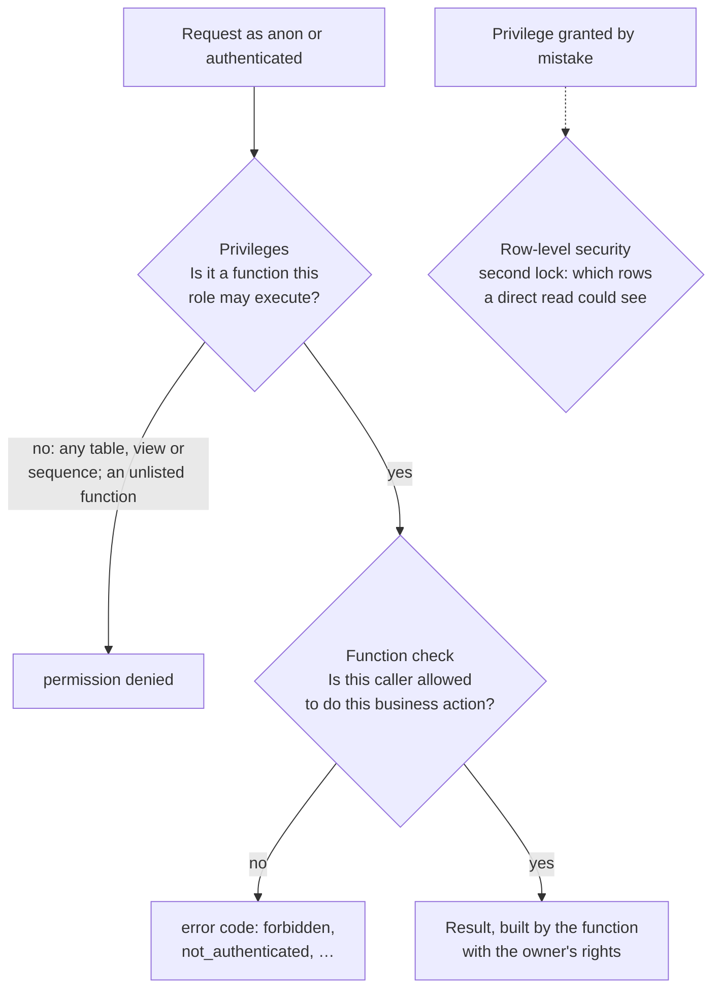

# Access control

Who can reach what, and how that is enforced. The short version: every request
arrives at the database as one of two unprivileged roles, with the signed-in
user's identity attached; those roles can touch **no table, view or sequence
at all**, only execute functions; each function checks its caller; row-level
security sits underneath as a second lock; and no app holds a key that skips
any of it.

Source: `supabase/migrations/20261121082800_lockdown.sql` for privileges and
the current policies (it supersedes the grants of `…081400_access_control.sql`),
`…080100_identity.sql` for the role helpers, `…082900_integrity.sql` and
`…083000_limits.sql` for the rules on money, returns, the delivery code and
the limits, `…083100_merge.sql` for account deletion, and the checks inside
each function. Tested by `supabase/tests/020_access.sql` (each kind of user, through
the functions they call), `070_api.sql` (each screen function, right and wrong
caller) and `110_lockdown.sql` (a guard over the whole catalogue, plus every
finding of the November 2026 security review replayed), all of which run as
real API roles with real claims.

## The roles a request can have

| Postgres role   | Who it is                                                                   | How a request gets it                                                                                                                                                                                |
| --------------- | --------------------------------------------------------------------------- | ---------------------------------------------------------------------------------------------------------------------------------------------------------------------------------------------------- |
| `anon`          | A visitor who is not signed in                                              | The publishable key alone                                                                                                                                                                            |
| `authenticated` | Any signed-in person: shopper, seller, driver, warehouse associate or staff | The publishable key plus the user's session token                                                                                                                                                    |
| `service_role`  | Bypasses row-level security                                                 | A secret key. **No app has one.** Only the notification worker uses one, its own, and calls only the `worker_*` functions, which are granted to `service_role` alone and also check the token's role |

Everything a signed-in person is beyond "a shopper" comes from rows, not from
the token:

| They are…                       | Because of a row in…            | Checked by                                                            |
| ------------------------------- | ------------------------------- | --------------------------------------------------------------------- |
| Internal staff, with a role     | `staff_members` (`active`)      | `private.is_staff()`, `private.has_staff_role(…)`                     |
| A member of a seller account    | `seller_members`                | `private.is_seller_member(seller)`, `private.is_seller_admin(seller)` |
| A warehouse associate at a site | `warehouse_staff`               | `private.works_at(warehouse)`                                         |
| An active driver                | `drivers` (`status = 'active'`) | `private.my_driver_id()`, `private.drives_route(route)`               |

Because these are looked up on every request, removing the row removes the
access immediately. A token that is still valid for an hour does not keep a
dismissed employee in the console.

**Staff and a second factor.** `private.staff_session_ok()` is part of every
staff check. When the setting `require_staff_mfa` is true, it requires the
session token's `aal` claim to be `aal2` — that is, the person completed
multi-factor sign-in for this session. With the setting on, a staff member who
signed in with a password alone has exactly a shopper's access. The setting
ships as `false` and must be turned on before launch.

**Any account with a second factor.** Whatever the setting, `private.factor_ok()`
is true only when the session is `aal2` or the account has no verified factor.
It is part of `staff_session_ok`, of the seller helpers (`is_seller_member`,
`is_seller_admin`, `my_seller_ids`) and of the deletion functions, so a
password alone opens nothing that the factor protects.

**Before every Data API request** PostgREST runs `public.check_request()`
(`pgrst.db_pre_request` on the `authenticator` role). It refuses a token whose
account has been deleted or whose session no longer exists (`session_ended`:
signing out, a password change, a factor reset and a deletion take effect at
once, not when the token expires), and a password-only session of an account
with a factor for everything except the second-step screen's own functions
(`second_factor_required`). For writing requests it holds the account's
sign-in row `FOR KEY SHARE`, which `delete_my_account` locks `FOR UPDATE`, so
requests and the deletion of the same account are serialised. Realtime and
Storage do not run it: their policies must use the helpers above, which
include `factor_ok`. The visitor and the server-side caller have no user id,
so for them it returns at once: grants and policies decide.

**Storage** does not run `check_request`. The product-photo rules on
`storage.objects` therefore start with `private.session_alive()` (account not
deleted, session not ended) and `private.factor_ok()`, and then use the same
seller and staff helpers. They never read a public table directly; what they
need about a photo comes from definer helpers.

## Three layers



### 1. Privileges: the functions are the only door

On Supabase, every table, view and sequence that `anon` or `authenticated`
holds any privilege on is reachable over HTTP (`/rest/v1/<table>`), whether or
not an app uses it. The security review of 21 November 2026 found most of its
holes there: column grants that let a seller attach an offer to a competitor's
listing or set a listing's tax rate, support staff re-open a refunded return,
any staff role read every delivery code. So the rule is now absolute:

- **Tables, views, sequences: nothing.** `anon`, `authenticated` and PUBLIC
  hold no privilege — no `select`, `insert`, `update` or `delete`, no column
  privilege, no sequence `usage` — on anything in `public` or `private`. The
  lockdown migration revokes them by sweeping the catalogue rather than naming
  tables, so it also covers tables added by migrations that ran before it.
- **Nothing granted by default.** The default privileges of `postgres` (the
  role the migrations run as) give the API roles and PUBLIC nothing on new
  tables, sequences or functions, in any schema and globally (a default set
  for one schema is not cancelled by a revoke for another, so the migration
  sweeps every default `postgres` holds, except in the platform's `auth` and
  `storage` schemas). A hosted Supabase project ships with defaults
  that grant `anon`, `authenticated` and `service_role` everything new in
  `public`; the local shim copies that, and the migrations switch the API
  roles' part off on both. `service_role`'s defaults are the platform's and
  are left alone; no app holds that key.
- **Functions: a named list.** Every function in `public` runs with its
  owner's rights (`security definer`) and `search_path = ''`, and checks its
  caller first. Visitors may execute only the functions listed
  [below](#what-each-role-may-execute). Signed-in users may execute every
  function in `public` except the internal ones listed there. PUBLIC may
  execute nothing in `public` or `private`.

`110_lockdown.sql` fails when any of this stops being true: a privilege on a
table, view or sequence; a function in `public` that is not owner's-rights
with an empty search path; a function executable by a role the list does not
name; a table without row-level security; a policy that reads another table of
`public` or `private` directly, or calls a function that runs with the
caller's rights; a policy other than `for select` on our tables; a default
that would grant new objects; a deferred trigger without
its owner's rights. It is what keeps the door closed when later migrations are
merged.

That last one was found the hard way. The ledger's balance check is a deferred
trigger: it runs at commit, after the function that wrote the entries has
returned, so with the API role's rights, which can read nothing. The SQL suites
never saw it fail, because each rolls back instead of committing; the browser
journeys, which commit, did. It now runs with its owner's rights.

A consequence: **a legitimate action exists only if a function does it.**
Some writes that used to be possible directly have no function yet: editing a
shop's name, description, logo or fiscal details; managing a shop's members;
withdrawing a consent; moderating a review; editing categories, brands,
synonyms, fees, delivery zones or the calendar; changing a listing's photos or
switching a variant off. None of them was used by an app; each needs a
function before it can be done again through the API. (Since then: photos in 082700; members and the shop's name,
fiscal details and contact in 083000; variants, a listing back to draft, an
offer on another shop's listing and the shop's description and logo in 083600;
categories, brands, search synonyms and review moderation in 083700, see
[Catalogue staff](#catalogue-staff).)

Supabase's own guidance is the same model — privileges decide whether a role
can touch an object at all, policies decide which rows — and the platform is
moving its defaults toward revoking automatic grants. The migrations do not
depend on which default a project has: they revoke either way.

### 2. Function checks

A `security definer` function runs with its owner's rights, so row-level
security does not constrain it; the function is responsible for checking the
caller. Every one of them does, in its first lines, and refuses with a stable
error code (`not_authenticated`, `forbidden`, or a "not found" that does not
reveal whether the thing exists).

The browsing functions (`search_products`, `get_product`, `cart_lines`,
`list_categories`, `my_orders` and the like) used to run with the caller's
rights and let the policies filter what they read. They now run with the
owner's rights and write the same visibility rules into their own `where`
clauses: active listings in active categories for everyone, plus drafts and
switched-off categories for staff, and a seller's own listings for that
seller. Their results did not change.

### 3. Row-level security: the second lock

Enabled on every table in `public` and `private`. No API role can read a
table directly any more, so the policies no longer decide what a screen shows;
they are there so that a privilege granted by mistake still exposes only the
rows its policy allows. Only **read** policies remain on the tables in `public`
and `private`: the lockdown migration drops every other policy it finds
(including `for all`), and `110_lockdown.sql` fails if one is added later, so
even a mistaken `insert`, `update` or `delete` grant is refused by row-level
security. Two read policies were narrowed after the review: customer profiles
are readable by support (not every staff role), and driver records by ops (not
support). `110_lockdown.sql` tests the policies themselves too: it grants the
mistaken privilege inside its own rolled-back transaction and checks what each
kind of user would then see.

Policy style, which matters for both correctness and speed:

- Role checks are wrapped in a sub-select — `(select private.is_staff())` — so
  Postgres evaluates them once per statement, not once per row.
- **A policy never reads another table directly.** It asks an owner's-rights
  helper in `private` (`private.can_see_order(order_id)`,
  `private.can_see_product(product_id)`, …). A policy that read
  `public.orders` itself would fail for lack of a privilege, and would recurse
  into that table's own policies. This holds for policies in any schema,
  including those on storage objects; the guard test checks it.
- In a sub-query inside a policy, **every reference to the outer table's column
  is qualified with the table name.** The reason is the bug described
  [below](#a-real-bug-and-what-it-taught).

## What each kind of user can do

A summary; the migration is authoritative.

### Visitor (`anon`)

| Can                                                                           | Cannot                                                                                                  |
| ----------------------------------------------------------------------------- | ------------------------------------------------------------------------------------------------------- |
| Search and browse active products from active sellers; read published reviews | See drafts or rejected listings, or find a pending or suspended seller's products in search (see below) |
| List categories and districts                                                 | Read any table: no profile, address, order, stock level or seller's private details                     |
| See delivery fees and dates in a quote                                        | Read the fee schedule, zones or calendar themselves                                                     |
| Get a delivery estimate and a checkout quote                                  | Place an order                                                                                          |
| Report a listing, review or shop that is public, giving an e-mail address     | Read the report queue; report something that does not exist or is not public                            |

Everything in this table is what the ten functions [listed
below](#what-each-role-may-execute) return; a visitor can reach nothing else.
One gap: `get_product` and `shop_path_exists` still open the product page of a
listing created by a seller who has since been suspended, if a visitor has its
address. Search no longer lists it, and the direct read the review used is
closed, but that rule of the two functions is not yet changed.

### Shopper (any signed-in user)

| Can                                                                                                               | Cannot                                                                                    |
| ----------------------------------------------------------------------------------------------------------------- | ----------------------------------------------------------------------------------------- |
| Read and edit their own profile (name, phone, locale, marketing choice)                                           | Mark their own phone as verified                                                          |
| Add, edit and soft-delete their own addresses                                                                     | See anyone else's                                                                         |
| Place, pay (in sandbox), cancel and read their own orders, including the delivery PIN                             | Read another person's order — it answers "not found", the same as one that does not exist |
| Review a product they received; request a return; withdraw a claim still waiting for a decision; file a complaint | Review something they did not buy, or twice; withdraw a return staff already decided      |
| Record and withdraw their own consents, dated by the database                                                     | Back-date a consent, change one, or undo a withdrawal                                     |

### Seller member

| Can                                                                                                                                                               | Cannot                                                                                                                                                                                                                           |
| ----------------------------------------------------------------------------------------------------------------------------------------------------------------- | -------------------------------------------------------------------------------------------------------------------------------------------------------------------------------------------------------------------------------- |
| Read their seller's private details, members, listings, offers, stock, statements and payouts                                                                     | Read another seller's                                                                                                                                                                                                            |
| Create listings as draft or pending review; edit their content; set price, handling time and status of their offers                                               | Publish a listing; change a published listing except through a reviewed edit; write ranking, rating or summary columns                                                                                                           |
| See the order lines they sold and each line's progress, with the shopper's first name, district and cantón                                                        | See the shopper's full name, phone, e-mail, address or map pin — Yuntera delivers, so the seller never needs them                                                                                                                |
| Set stock at their own location; announce stock sent to a warehouse; mark their own parcels packed                                                                | Change stock held in a Yuntera warehouse                                                                                                                                                                                         |
| Read their shop's stock history (`seller_stock_history`): every change to its on-hand units, with the warehouse's reason for a count correction                   | See who in the warehouse made a change, a shopper behind it, or the warehouse's moves between shelves                                                                                                                            |
| Reply to a review of their product                                                                                                                                | Remove or edit a review                                                                                                                                                                                                          |
| Admins and owners: invite members (they must accept), remove staff, ask for a change of payout account, shop name, fiscal details or contact (staff approve each) | Add anyone without their acceptance; change the payout account, name, fiscal details or contact directly; read an account number in full; create, alter or remove an owner; change the shop's description or logo without review |
| Add photos to their listings through the photo functions and upload the reserved files; download their own photos under review                                    | Sign a link to a photo that is not approved, overwrite or move a file, publish a photo, read another shop's files                                                                                                                |
| Admins and owners: choose the shop's WhatsApp and push channels and its commercial consent                                                                        | Switch off the shop's e-mail, or switch on a number that opted out                                                                                                                                                               |

### Warehouse associate

| Can                                                                                                                                                                                                                                                                                                                                                                                                                                                                                                                                    | Cannot                                                                                                                                                                                                                                                                                                           |
| -------------------------------------------------------------------------------------------------------------------------------------------------------------------------------------------------------------------------------------------------------------------------------------------------------------------------------------------------------------------------------------------------------------------------------------------------------------------------------------------------------------------------------------- | ---------------------------------------------------------------------------------------------------------------------------------------------------------------------------------------------------------------------------------------------------------------------------------------------------------------- |
| At the sites they are assigned to: see the floor board, pick lists, bins, stock and inbound shipments                                                                                                                                                                                                                                                                                                                                                                                                                                  | See other sites                                                                                                                                                                                                                                                                                                  |
| Receive, put away, pick, pack, adjust stock with a note                                                                                                                                                                                                                                                                                                                                                                                                                                                                                | See shoppers' addresses or phones, prices paid, or payments                                                                                                                                                                                                                                                      |
| Open a location and see what it holds, what is promised and free (`wms_stock_locations`, `wms_location_stock`); move free units to a shelf of the same site (`wms_move_stock`); correct a count with a reason, only onto shelves (`wms_adjust_stock`); check in a returned parcel; count units of a product the location does not list onto it, only for a shop that already has a stock record in this site, after finding it by code, barcode or name among what this site keeps (`wms_count_candidates`, `wms_count_into_location`) | Move promised units, move into another site or a non-shelf area, count units into a switched-off location or the damaged, packing and dispatch areas; create a shop's first units of a product in a site by counting (that is a receipt), or count a product onto a location that already lists it for that shop |

### Driver

| Can                                                                                                                         | Cannot                                                                                  |
| --------------------------------------------------------------------------------------------------------------------------- | --------------------------------------------------------------------------------------- |
| See routes assigned to them and, for each stop: recipient name, phone, _señas_, pin location, parcels, cash to collect      | See the delivery PIN, the order's contents or price, or any other order of that shopper |
| Start a route, arrive, complete a stop with the shopper's PIN, record a failed attempt with a reason, report their position | Read a route's stops more than 24 hours after it was completed                          |
| See their own cash settlements                                                                                              | See another driver's route or position                                                  |

### Staff

Admin implies every role below. "Reach" is what the `ops_*` and other staff
functions return to that role; the read policies name the same roles, but only
as the second lock.

| Role      | Reach                                                                                                                                                                                                                                                                                           |
| --------- | ----------------------------------------------------------------------------------------------------------------------------------------------------------------------------------------------------------------------------------------------------------------------------------------------- |
| `ops`     | Orders, sellers' private details, drivers, warehouses and staff assignments, the dispatch board, routes, settlements, returns; approve or suspend sellers; the Operación tools of 084000 (zones, districts, holidays, closures, warehouse locations, stuck routes)                              |
| `support` | Orders and timelines (with the shopper's contact and address), sellers' private details, returns, complaints, content reports; cancel an order for a shopper; see which messages an order produced and resend a stuck one                                                                       |
| `finance` | Orders, fee schedule, seller statements, the ledger, settlements, invoices; decides sellers' bank-detail requests; previews, creates and settles payout runs; sees offers a fee change paused (`ops_fee_floor_breaches`, also `catalog`)                                                        |
| `catalog` | All listings; approve or reject a listing, a listing edit and its photos; take down any photo; resolve content reports; categories, brands (deleting an unused one since 084100), search synonyms, review moderation, and correcting, taking down and putting back a published product (083700) |
| `admin`   | All of the above, plus staff membership, the audit log and resetting a colleague's second factor (never their own); the operational settings (084000; every other setting is protected)                                                                                                         |

Sensitive changes by staff — to staff membership, seller status and private
details, drivers, warehouse assignments, settings, fees, payouts — are written
to `private.audit_log` with the acting user, and that log cannot be altered.
A bank account number is never copied into it: only its last four digits.
Nor are a driver's name, phone, identification number, plate or licence
dates, or a shop's legal name, identification, contact details, address and
SINPE number: the log records which of those columns changed, by name only.

Two rules about people and money are enforced below the functions, on the
tables themselves. The platform always keeps one active administrator: a
trigger on `staff_members` refuses the change that would remove the last one.
And nobody writes a seller's payout account or a payout directly: sellers ask
with `seller_request_payout_details`, finance decides with
`ops_decide_payout_details`, and `payouts`, `payout_runs` and
`payout_detail_requests` have no grant to any API role at all. The full account
number is readable only through two finance functions (a request awaiting a
decision, and a run's transfer list). Finance confirms a change by calling the
shop's phone on file, so sellers cannot change that phone or the contact e-mail
directly either, and a request made within 30 days of a change to them is
flagged. Nobody in finance decides a request they made, or one for a shop they
belong to.

## Catalogue staff

Migration `20261121083700_console_catalogue.sql` gives catalogue staff (and
administrators; every other staff role gets `forbidden`) a door for each
catalogue change they used to make by writing tables. Every one is audited:
categories, brands and synonyms by the audit trigger on their tables,
reviews and products by an entry the function writes (a review's text is
never copied into the log, only its id, the reason and the rating).

| Change              | Function                                                                                                                                  | Rules                                                                                                                                                                                                                                                                                                                                                      |
| ------------------- | ----------------------------------------------------------------------------------------------------------------------------------------- | ---------------------------------------------------------------------------------------------------------------------------------------------------------------------------------------------------------------------------------------------------------------------------------------------------------------------------------------------------------- |
| Categories          | `ops_create_category`, `ops_update_category`, `ops_move_category`, `ops_shift_category`, `ops_set_category_active`, `ops_delete_category` | Three levels at most, no loops, names unique among siblings; an address is unique among categories and their old addresses and never a word the shop keeps (`buscar`, `carrito`…); a renamed address stays as a redirect (`category_redirect`); a move that would change the commission of a listed product is refused; only an unused category is deleted |
| Brands              | `ops_create_brand`, `ops_update_brand`, `ops_set_brand_active`, `ops_merge_brands`, `ops_delete_brand` (084100)                           | Names unique (accents and case ignored) including old names; a merge moves the products and keeps the old name for search and the old address for the filter; only a brand no product names, in any status, is deleted (`brand_in_use` with the count), with the brands merged into it, and its addresses are free again                                   |
| Search synonyms     | `ops_add_search_synonym`, `ops_remove_search_synonym`, `ops_search_preview`                                                               | Stored folded with single spaces, as search reads them; refused when empty, too long, repeated, a word search ignores, or matching nearly every listing                                                                                                                                                                                                    |
| Reviews             | `ops_reviews`, `ops_hide_review`, `ops_show_review`, `ops_hide_review_reply`, `ops_show_review_reply`                                     | A reason from a fixed list (never a low rating); the rating follows at once; open reports about it close as acted on; staff see of the reviewer only the shop's "María F."; the author reads why on their order (`my_order_reviews`)                                                                                                                       |
| A published product | `ops_catalog_product`, `ops_correct_product`, `ops_take_down_product`, `ops_restore_product`                                              | Category and brand corrected with a reason the seller reads; refused while the seller's own edit waits, or when an offer would sell below the fees; a take-down is a rejection with a reason that can be put back, as it was (refused once the seller changed it); the seller is told (`product.staff_changed`)                                            |

`ops_resolve_report` uses the same doors: acting on a product report is a
take-down staff can undo, and acting on a review report hides the review with
the reason closest to the report's.

A product page opens (`private.product_page_open`, which `get_product` and the
shop's other product reads ask) for everyone only while the product is on sale
and its shop is active or another active shop sells it. A product that is not
on sale (a draft, waiting for review, taken down, archived) opens only for
staff and for members of the shop that created it, as their preview; since
084100 the helper itself says so, not only its callers.

## Operations staff

Migration `20261121084000_console_operations.sql` gives operations staff (and
administrators; support, finance and catalogue staff get `forbidden`) a door
for the operational data that had none after the lockdown. Settings are for
administrators only. Every function needs the second step like everything
else (none is on `check_request`'s short list). Each change is audited: zones,
holidays, closed days and settings by the audit triggers on their tables;
districts, closure periods, warehouse locations, route stops and routes by an
entry the function writes, with codes and statuses only, never the free text
staff typed (a stop holds the recipient's name and phone).

| Change              | Function                                                                                             | Rules                                                                                                                                                                                                                                                           |
| ------------------- | ---------------------------------------------------------------------------------------------------- | --------------------------------------------------------------------------------------------------------------------------------------------------------------------------------------------------------------------------------------------------------------- |
| Delivery zones      | `ops_delivery_zones`, `ops_create_zone`, `ops_update_zone`, `ops_set_zone_active`, `ops_delete_zone` | Edits carry the zone's revision (`zone_changed_meanwhile`); a new zone starts off; the shop always keeps a served district (`zone_last_active`, `zone_has_no_districts`); only an unused zone is deleted                                                        |
| Districts           | `ops_district_cantons`, `ops_canton_districts`, `ops_district_move_preview`, `ops_move_districts`    | 1 to 60 at a time, to a zone or to "not served"; a move that would leave nothing served is refused (`districts_none_served`)                                                                                                                                    |
| Holidays            | `ops_holidays`, `ops_add_holiday`, `ops_remove_holiday`                                              | Days after today, at most 730 ahead; refused on a day with routes, confirmed on a day with promised orders                                                                                                                                                      |
| Zone closures       | `ops_zone_closures`, `ops_open_zone_closure`, `ops_change_zone_closure_end`, `ops_end_zone_closure`  | A period of at most 31 days from today; an overlapping closure of the same zone is refused; edits carry a revision                                                                                                                                              |
| Settings (admin)    | `ops_settings`, `ops_update_setting`                                                                 | Only the 16 operational limits, within their range and against the value the administrator saw; every other key is protected (`setting_protected`)                                                                                                              |
| Warehouse locations | `ops_warehouse_locations`, `ops_create_location`, `ops_rename_location`, `ops_set_location_active`   | Storage and picking locations of a Yuntera warehouse only; not switched off while holding stock, named in an open pick task, with units picked from it in a parcel being picked, or as the last active one; a trigger keeps stock out of a location that is off |
| Stuck routes        | `ops_open_routes`, `ops_remove_route_stop`, `ops_close_route`                                        | Only a pending stop is removed (kept as skipped, with who and why); a route closes only with no stop out; no delivery code, name or phone is read or returned                                                                                                   |
| Stopping a parcel   | `ops_recall_shipment` (084200)                                                                       | A packed parcel of a Yuntera warehouse, or one on a route that has not started, with a reason of at least 5 letters; not a seller's own parcel, not one on a started route; audited with the status it had                                                      |
| Single closed days  | `ops_remove_zone_closure_day` (084200)                                                               | A day that belongs to no period, today or later; audited                                                                                                                                                                                                        |
| Stock moves         | `ops_stock_changes` (084300)                                                                         | Reads the warehouse's moves and count corrections with who made them; no shopper data                                                                                                                                                                           |

Seller pickup points (`seller_save_location`) follow the same "not served"
rule since 084000.

Migrations `084200` and `084300` add the functions in the last three rows and
the warehouse's location screens (`wms_stock_locations`, `wms_location_stock`,
`wms_move_stock`, a stricter `wms_adjust_stock`: a worker of the site or
operations staff), and the shop's stock history (`seller_stock_history`: a
member of the shop, or operations or support staff). All are granted to
`authenticated` only; none to visitors.

Migration `084500` adds the count of a product a location does not list
(`wms_count_candidates`, `wms_count_into_location`): a worker of the
location's warehouse or operations staff, granted to `authenticated` only.
Migration `084600` re-creates `cart_alternatives` with an optional district
and grants it again to visitors and signed-in users, as before; the new
`private.refund_announcement` is granted to no app role. Migration `084400`
changes no grant.

## Access that ends at once

Every check reads the row that grants the access, on every call, so taking
the row away ends the access with the next request. What each kind of
account keeps, tested function by function in `supabase/tests/120_limits.sql`
(each prefix is called with every argument it takes, and every call must
refuse):

| Account                                 | What happens                                                                                                                                                                                                                                                                                                                                                                                                                                                                                                                                                                                                                                                                    |
| --------------------------------------- | ------------------------------------------------------------------------------------------------------------------------------------------------------------------------------------------------------------------------------------------------------------------------------------------------------------------------------------------------------------------------------------------------------------------------------------------------------------------------------------------------------------------------------------------------------------------------------------------------------------------------------------------------------------------------------- |
| Driver suspended, offboarded or pending | `driver_today` returns their own record and no routes (it is a gate in front of whatever body the function had, moved to `private.driver_today_active`); every other driver function refuses, also when given the driver's own route and stop ids. Their routes go back to dispatch at once (a trigger on `drivers`, whatever path changed the status): a route not started becomes a draft without driver; of a route being driven, the stops still to do move to a new draft route and the old one closes with its cash count for the driver who collected the money. `ops_released_routes` lists them on the dispatch screen, with the parcels still in that driver's hands. |
| Staff member switched off               | Every `ops_*` function and the audit trail refuse (`forbidden`): `has_staff_role` reads `active`.                                                                                                                                                                                                                                                                                                                                                                                                                                                                                                                                                                               |
| Warehouse worker removed from a site    | Every `wms_*` function refuses for that site.                                                                                                                                                                                                                                                                                                                                                                                                                                                                                                                                                                                                                                   |
| Member removed from a shop              | Every `seller_*` function refuses for that shop, also when given the ids of its listings, offers, reviews and parcels; nothing of it stays readable. Invitations they sent as an administrator are withdrawn, and an invitation whose sender is no longer allowed to send it cannot be accepted.                                                                                                                                                                                                                                                                                                                                                                                |
| Shop pending (not yet verified)         | Reads its data, keeps drafts, invites its team, asks for changes. Cannot send a listing for review, edit a published one or announce stock to a warehouse (`shop_not_approved`). A listing it sent earlier cannot be published until the shop is verified (`listing_shop_not_active`, a trigger on `products`, so it holds whatever version of `ops_review_product` is in place).                                                                                                                                                                                                                                                                                               |
| Shop suspended                          | As pending, and also cannot put an offer back on sale or reply publicly to a review. It can still pause offers, count stock, pack what it already sold and be paid what it is owed later.                                                                                                                                                                                                                                                                                                                                                                                                                                                                                       |
| Shop closed                             | Reads only: no pickup points, no stock counts (`shop_closed`), no listings, offers, inbound shipments, invitations or change requests. It may still ask for its payout account to be changed, so that it can be paid what it is owed; finance decides that request as any other.                                                                                                                                                                                                                                                                                                                                                                                                |

## Limits against abuse

The database cannot trust a caller's network address: the apps call it from
their own servers, and anyone with the publishable key can call it directly
and claim any address. So no limit below depends on one. They are of four
kinds: the thing acted on must exist and be public; a repeat is the same
thing, not a second one; one account can have only so much open at a time;
and what a visitor can send is bounded before any work is done. Each is a
setting in `app_settings` (an administrator changes it without a migration)
or a named constant in the function, and each is tested at its edge.

| Limit                                        | Value                                                               | Where                                                                                                                      | Why this number                                                                                                                                                                                                                                  |
| -------------------------------------------- | ------------------------------------------------------------------- | -------------------------------------------------------------------------------------------------------------------------- | ------------------------------------------------------------------------------------------------------------------------------------------------------------------------------------------------------------------------------------------------ |
| Shops waiting for verification per account   | 1 (`max_pending_shops_per_account`)                                 | `create_seller`                                                                                                            | Nobody honest needs two at once; the second can be registered as soon as the first is decided.                                                                                                                                                   |
| Listings in review per shop                  | 50 (`max_listings_in_review_per_seller`)                            | `seller_create_listing`, `seller_update_listing`                                                                           | New listings and edits of published ones together. Enough for a shop's first catalogue upload; more waits as drafts.                                                                                                                             |
| Drafts per shop                              | 200 (`max_draft_listings_per_seller`)                               | `seller_create_listing`                                                                                                    | Drafts are never reviewed; this only stops a table from filling up.                                                                                                                                                                              |
| Open inbound shipments per shop              | 10 (`max_open_inbounds_per_seller`)                                 | `seller_create_inbound`                                                                                                    | Each is an expected delivery on the dock's board; ten covers a week of daily deliveries.                                                                                                                                                         |
| Lines per inbound shipment; units per line   | 100; 100 000                                                        | `seller_create_inbound`                                                                                                    | A shipment is a truckload, not the catalogue. A repeated product is refused (`invalid_lines`).                                                                                                                                                   |
| Open reports per signed-in account           | 20 (`max_open_reports_per_account`)                                 | `report_content`                                                                                                           | Someone reporting genuinely rarely has more waiting; a repeat of an open report (same target and reason) returns the same report.                                                                                                                |
| Visitor reports per hour, whole platform     | 300 (`visitor_reports_per_hour`)                                    | `report_content`                                                                                                           | A safety valve, about ten times the expected volume. Above it a visitor is asked to write to support, except about something nobody has reported yet: that first report always gets in, so a flood cannot silence the reports about one listing. |
| Open complaints per account                  | 5 (`max_open_complaints_per_account`)                               | `file_complaint`                                                                                                           | The same complaint again (same order, category and text) returns the first.                                                                                                                                                                      |
| Invitations waiting per shop; team size      | 20; 50 (`max_pending_invitations_per_shop`, `max_members_per_shop`) | `seller_invite_member`                                                                                                     | A small business's team, with room.                                                                                                                                                                                                              |
| Search text                                  | 200 characters, 12 words                                            | `search_products`, `suggest_products`                                                                                      | Longer input is cut, not refused. The unbounded bodies are private and reachable only through these wrappers. The same numbers are `SEARCH_INPUT_LIMITS` in `packages/core/src/search.ts`, kept equal by a unit test.                            |
| Lines in a checkout quote                    | `max_lines_per_order` (40)                                          | `checkout_quote`                                                                                                           | Counted before any pricing work; malformed lines are answered as an issue.                                                                                                                                                                       |
| Lines in an order                            | `max_lines_per_order` (40)                                          | `place_order`                                                                                                              | Counted before anything is locked or priced, as in a quote.                                                                                                                                                                                      |
| Unpaid orders per account                    | 3 (`max_unpaid_orders_per_account`)                                 | `place_order`                                                                                                              | A product cannot be taken off sale with orders nobody pays.                                                                                                                                                                                      |
| Units held in other unpaid orders            | 30 (`max_held_units_per_account`)                                   | `place_order`                                                                                                              | One order on its own is held only to the per-order limits.                                                                                                                                                                                       |
| Units of one offer held unpaid               | `max_units_per_line` (10)                                           | `place_order` (`offer_held_limit`)                                                                                         | Across all the account's unpaid orders.                                                                                                                                                                                                          |
| Open cash orders, account never delivered to | 2 (`max_open_cod_orders_new_account`)                               | `place_order` (`cod_limit_reached`)                                                                                        | Cash on delivery from an untried account.                                                                                                                                                                                                        |
| Wrong delivery codes per order               | 5 (`private.delivery_code_max_attempts`)                            | `driver_complete_stop`                                                                                                     | Across all parcels, stops and routes; then the order locks until staff release it.                                                                                                                                                               |
| Staff queues                                 | 100 per page, oldest first                                          | `ops_care_queues` (with totals), `ops_listings_for_review`, `wms_board` (with `inbound_total`), `ops_shop_change_requests` | The payload no longer grows with whatever was filed.                                                                                                                                                                                             |
| Report details; complaint text               | 2 000; 10–4 000 characters                                          | `report_content`, `file_complaint`                                                                                         | What a person writes about one problem.                                                                                                                                                                                                          |

Reports must be about a listing, review or shop a shopper can see. The
e-mail a visitor types is recorded only as a contact detail staff may use by
hand: nothing sends a message to it, and the event the report emits does not
carry it. Where the notifications tables exist (migration 082600), a trigger
drops any delivery planned for a visitor's typed address (`report:<id>`)
before it is stored. The same rule holds for invitations to a shop: the event names the
invited account (whose address its owner proved), never the address typed.

Shop registration accepts an identification number another shop uses, with
the same answer as any other registration, so it reveals nothing; staff see
the clash (`ops_seller_id_clashes`) and only one shop can ever be verified with
a number (a partial unique index). A name that contains "yuntera" (ignoring
spaces and punctuation), sounds like the platform speaking (soporte, ayuda,
oficial…), uses another alphabet, or reads the same as another active shop's
name is refused, at registration and when a change of name is requested.

## Changes only a function makes

| Change                                   | How                                                                                                                                                                                                                                                                                                                                                                                                                                                                                                                                                                                                                                                                                                                                                                                                                                                                                                                             |
| ---------------------------------------- | ------------------------------------------------------------------------------------------------------------------------------------------------------------------------------------------------------------------------------------------------------------------------------------------------------------------------------------------------------------------------------------------------------------------------------------------------------------------------------------------------------------------------------------------------------------------------------------------------------------------------------------------------------------------------------------------------------------------------------------------------------------------------------------------------------------------------------------------------------------------------------------------------------------------------------- |
| Joining a shop                           | `seller_invite_member` (owner or admin; only the owner offers "admin"), then the invited account's `seller_answer_invitation`. The invitation is bound to the account that had the address when it was sent; if none had it, the account that later signs up with that address and confirms it (proving it owns the mailbox) can answer, and one whose address is not confirmed cannot. It expires after 14 days, can be accepted only while whoever sent it may still send it, and the owner (or an admin, for staff) can revoke it. `seller_remove_member` and `seller_set_member_role` replace direct writes; nobody changes the owner.                                                                                                                                                                                                                                                                                      |
| The shop's name, fiscal details, contact | `seller_request_shop_change`, decided with `ops_decide_shop_change`: ops decide names and fiscal details, finance decides the contact (it is the phone finance calls to confirm a new payout account). A change of contact and a change of payout account never wait at the same time: whichever is sent first holds the other back (`payout_request_open`, `contact_request_open`), and finance cannot approve a contact change while a payout-account request waits (`contact_change_waits_for_payout`; rejecting stays possible), so the phone finance calls to confirm a new account is never one that is itself being changed. An approved contact change flags the next payout-account request. A fiscal-details request keeps every field the seller leaves blank as it is on file, so changing the address never clears the postal or activity code. Nobody decides their own request or one for a shop they belong to. |
| Consents                                 | `record_consent` (only the policy version in force, in `app_settings.policy_versions`; agreeing again adds nothing) and `withdraw_consent`. A trigger dates every consent and withdrawal with the database's clock and refuses any other change, whoever makes it.                                                                                                                                                                                                                                                                                                                                                                                                                                                                                                                                                                                                                                                              |
| Fees                                     | **Not through the API at all.** Commission rates, warehouse and payment fees and shipping prices change in a migration, where the parity test with `packages/core/src/fees.ts` keeps both sides equal. No API role has a write grant on the fee tables, `categories` or `delivery_zones`, and every change to them (and to holidays and zone closures) is in the audit log.                                                                                                                                                                                                                                                                                                                                                                                                                                                                                                                                                     |
| Payout account approval                  | Approving a request stamps `payout_approved_at`. An account on file that finance never approved is not paid (it counts as no approved account, in finance's run and on the seller's own money screen, `seller_payouts.blocked_by`), and `seller_payout_details.current.approved` lets the account screen ask the seller to send it for approval.                                                                                                                                                                                                                                                                                                                                                                                                                                                                                                                                                                                |
| An offer on another shop's listing       | `seller_add_offer`, by a member of an active shop whose identity staff verified, on an active variant of a published listing a shopper can open, never its own (`own_listing`). No review: the content was already reviewed and stays the creating shop's. At most `max_new_offers_per_day_per_seller` (30) a day, an archived offer on the same variant is put back instead of a second one, and the price floor holds as for any price. `seller_catalog_search` finds published products by name, brand or barcode for it.                                                                                                                                                                                                                                                                                                                                                                                                    |
| A variant off and on; a listing to draft | `seller_set_variant_active` and `seller_unpublish_listing`, by the shop that created the listing. A variant another active shop has an offer on sale on is not switched off: only the creating shop's own offer is paused. A listing another active shop has an offer on sale on cannot go back to draft or be archived (`listing_shared`); a paused offer holds nothing back. Its way back on sale is the review of a new listing.                                                                                                                                                                                                                                                                                                                                                                                                                                                                                             |
| The shop's description and logo          | The description is a shop change of kind `description` (`seller_request_shop_description`, decided by operations with `ops_decide_shop_change`); the logo goes through the photo pipeline (`seller_reserve_logo`, `seller_finish_logo`, decided by catalogue staff with `ops_review_logo` and published by the console). Removing the logo needs no review. Every change to what shoppers read about a shop is in the audit trail.                                                                                                                                                                                                                                                                                                                                                                                                                                                                                              |
| Who edits a shared listing               | The shop that created it, through the reviews. When that shop closes, each of its published listings another active shop sells passes to the shop with the oldest offer on sale on it, or the oldest paused one when no other is on sale (a trigger on `sellers`, whatever path closes it); the closed shop's published photos stay with it, and the shop's changes still waiting for review are withdrawn. A listing edit that would pause other shops' offers is approved only when catalogue staff confirm it (`ops_review_listing_edit` with `p_pause_offers`), after the queue has listed those offers; each shop is told.                                                                                                                                                                                                                                                                                                 |
| Packages sent to a warehouse             | Triggers on `offers` and `skus` refuse a warehouse offer whose package exceeds the largest fee tier (30 kg, 120 cm a side), whatever path tries. No listing at all may weigh more than 30 kg or measure more than 200 cm a side (`package_over_limit`): Yuntera carries no such package with any kind of delivery.                                                                                                                                                                                                                                                                                                                                                                                                                                                                                                                                                                                                              |

## Rules for `security definer` functions

These functions are the most powerful code in the system. The rules they follow:

1. **`set search_path = ''`**, and every object schema-qualified
   (`public.orders`, `private.fail`, `extensions.gen_random_bytes`). Without
   this, a caller who can create objects in any schema on the search path could
   plant a function or table with the same name and have it run with the
   owner's rights.
2. **Identify the caller from the token, never from an argument.** Functions
   use `(select auth.uid())`. No function accepts a user id to act as.
3. **Check before reading.** The permission check comes before any query whose
   result could leak through an error message or timing.
4. **Lock what you will change.** Rows that will be updated are selected
   `for update` first, in a consistent order, so concurrent calls cannot both
   pass a check and then both write.
5. **Fail with a code.** `private.fail('code')` raises SQLSTATE `P0001` with a
   stable message the client maps to text. Internal messages never reach a
   user.
6. **Granted explicitly.** `EXECUTE` is revoked from `public` and granted only
   to the role that should call it.

**The network extension's schema.** `pg_net` (enabled by 082600) grants
visitors and signed-in users the use of its schema `net`. Migration 083200
revokes it from both (schema, tables, sequences, functions); only
`private.notify_kick`, running as our functions' owner, calls it.
`125_followups.sql` fails while either role can still use `net`. On a hosted
project the grants may have been made by the platform's own role, which
`postgres` cannot revoke: the migration then prints a notice, and the test
shows it.

What to check on the hosted project, after applying 083200 and again after
any upgrade, disable or re-enable of `pg_net` (Supabase's documentation does
not say whether the platform re-grants on those; its open-source images do
so with an event trigger, `extensions.grant_pg_net_access`, so assume it
may):

```sql
-- all four must be false
select has_schema_privilege('anon', 'net', 'usage'),
       has_schema_privilege('authenticated', 'net', 'usage'),
       has_function_privilege('authenticated', 'net.http_post(text, jsonb, jsonb, jsonb, integer)', 'execute')
         and has_schema_privilege('authenticated', 'net', 'usage'),
       has_table_privilege('authenticated', 'net._http_response', 'select');
-- no row for anon or authenticated
select p.proname, a.grantee::regrole, a.privilege_type
from pg_proc p, aclexplode(p.proacl) a
where p.pronamespace = 'net'::regnamespace and a.grantee in ('anon'::regrole, 'authenticated'::regrole);
select 1 from pg_event_trigger where evtname = 'issue_pg_net_access';  -- if present, it re-grants on a re-create
```

The `net_grants` block of `supabase/tests/125_followups.sql` runs the same
checks and can be run against the hosted database as it is. If a check
fails, run section 8 of 083200 again (it is idempotent), and confirm that the
notification worker still wakes (`private.notify_kick` sends one request).

The `private` schema is not exposed by the Data API at all (a hosted project
exposes `public` and `graphql_public` only). `anon` and `authenticated` have
`USAGE` on it only so that row-level-security policies can call the yes-or-no
helpers listed below. Everything else in `private` — its tables, the audit
log, the outbox, the functions that capture payments and post to the ledger —
is readable or executable by no API role.

## What each role may execute

This is the list `110_lockdown.sql` checks against; a unit test in
`packages/db` keeps the two equal. Adding a function to a list is a decision:
name it here and in the test, and say why in the pull request.

**Visitors (`anon`)** may execute only these functions in `public`:

<!-- BEGIN visitor functions -->

- `auth_limit_release` (gives back a sign-in or code attempt that succeeded)
- `auth_limit_reserve` (the apps' limit on sign-in, sign-up, account e-mails,
  codes and refreshes, asked before anyone is signed in; it takes only keyed
  hashes, see [Limits on signing in](#limits-on-signing-in))
- `cart_alternatives` (for a cart line that can no longer be bought, another shop's offer of the same variant and, given a district, when it would arrive: public data of a product a shopper can open)
- `cart_lines`
- `category_redirect` (where an old category address points now, for the
  shop's permanent redirect)
- `check_request` (the Data API runs it before every request, a visitor's
  included; for a visitor it returns at once)
- `checkout_quote`
- `delivery_estimate`
- `get_product`
- `get_shop` (a shop's public page: name, description, logo and what it sells; only an active shop has one)
- `list_brands` (the brands of the shop's filter)
- `list_categories`
- `list_districts`
- `report_content`
- `search_products`
- `shop_path_exists`
- `suggest_products`

<!-- END visitor functions -->

**Signed-in users (`authenticated`)** may execute every function in `public`
that is not a trigger function and not one of these internal ones, which no
API role may execute:

<!-- BEGIN internal functions -->

- `reviewer_display_name` (turns an account id into a display name; only
  `get_product` calls it)

<!-- END internal functions -->

**Policy helpers.** Both `anon` and `authenticated` may execute these
functions in `private`, which row-level-security policies call. Each answers
yes or no (or "which ids") about the caller's own relationship to a row, from
the token:

<!-- BEGIN policy helpers -->

- `can_see_inbound`
- `can_see_order`
- `can_see_product`
- `can_see_shipment`
- `drives_route`
- `has_staff_role`
- `is_seller_admin`
- `is_seller_member`
- `is_staff`
- `my_driver_id`
- `my_seller_ids`
- `my_warehouse_ids`
- `owns_order`
- `route_open_to_driver`
- `sells_order_item`
- `seller_is_active`
- `works_at`
- `works_at_location`

<!-- END policy helpers -->

**Storage policy helpers.** Only `authenticated` may execute these functions
in `private`, which the rules on `storage.objects` for product photos call
(the storage service runs each file operation as the signed-in caller). Each
runs with its owner's rights and answers yes or no:

<!-- BEGIN storage policy helpers -->

- `photo_object_deletable`
- `photo_object_insertable`
- `photo_object_readable`

<!-- END storage policy helpers -->

**Server-side functions.** No API role may execute these functions in
`public`; only a platform role does. The notification worker calls the
`worker_notify_*` and `worker_push_*` functions, the payments worker and
webhook the `worker_payments_*` ones and the invoice worker the
`worker_invoice_*` ones, each with its own server-side key (`service_role`),
and Auth calls the hook (`supabase_auth_admin`):

<!-- BEGIN server-side functions -->

- `hook_mfa_verification_attempt` (Auth)
- `worker_invoice_claim`
- `worker_invoice_health`
- `worker_invoice_hint`
- `worker_invoice_plan`
- `worker_invoice_record`
- `worker_invoice_signed`
- `worker_notify_apply_update`
- `worker_notify_claim`
- `worker_notify_defer`
- `worker_notify_fail`
- `worker_notify_freeze`
- `worker_notify_plan`
- `worker_notify_sent`
- `worker_notify_skip`
- `worker_payments_claim`
- `worker_payments_event`
- `worker_payments_hello`
- `worker_payments_report`
- `worker_push_disable`
- `worker_push_receipts_due`

<!-- END server-side functions -->

**PUBLIC** may execute nothing in `public` or `private`. Beyond the
server-side functions above, `service_role` is the platform's own role and is
not managed here.

## Checklist: adding a function safely

Before the migration is merged, answer each of these in the pull request.

- [ ] **Who may call it?** Name the role or relationship. If the answer is
      "anyone signed in", say what stops them acting on someone else's data.
- [ ] **Owner's rights.** Every function is `security definer`; an invoker
      function can read nothing, because the API roles hold no table
      privilege. Then:
  - [ ] `set search_path = ''` and schema-qualify everything.
  - [ ] First statement checks the caller and fails with a code; a function
        visitors call writes its visibility rules into its `where` clause.
  - [ ] No argument can name another user to act as.
- [ ] **What does it return to the wrong caller?** "Not found" for things that
      belong to someone else; never a different error that confirms existence.
- [ ] **Does it return personal data?** List the fields and why each is needed
      by this audience. A seller does not need a shopper's phone; a driver does
      not need the order's contents.
- [ ] **Does it write?** Lock rows first; make it safe to call twice.
- [ ] **Grant.** `grant execute … to authenticated`, and never a privilege on
      a table, view or sequence. A function visitors must call also gets
      `anon`, and goes on [the list](#what-each-role-may-execute) and in
      `110_lockdown.sql`.
- [ ] **Errors.** Every `private.fail('code')` has a message (in an area file
      under `packages/db/src/areas/`). A unit test enforces this.
- [ ] **Client.** A method and a schema in an area file.
- [ ] **Tests.** A suite in `supabase/tests/`: one block proving the right
      caller gets the payload, and one proving each wrong caller is refused or
      gets nothing. A contract test: the response matches the schema.

Adding a table has a shorter list: enable row-level security, grant the API
roles **nothing** (`110_lockdown.sql` fails otherwise), write a read policy
whose checks on other tables go through helpers in `private`, qualify outer
columns, and reach the table only through functions.

## A real bug, and what it taught

During testing, a driver signed in and saw an empty route: stops but no
parcels. The policy on `shipments` was meant to say "a driver sees the parcels
on stops they can see":

```sql
-- As first written. Wrong.
or exists (select 1 from public.route_stops rs where rs.shipment_id = id)
```

Inside the sub-query, the bare `id` does not mean `shipments.id`. Postgres
resolves an unqualified name against the innermost table first, and
`route_stops` has its own `id`. The condition was silently comparing a stop's
`shipment_id` to that same stop's `id` — never true. No error, no warning: the
policy simply matched nothing.

```sql
-- As it is now.
or exists (select 1 from public.route_stops rs where rs.shipment_id = shipments.id)
```

This one failed closed: the driver saw too little. The same mistake with the
logic the other way round would fail open and show too much, just as silently.

What changed as a result:

- Every policy sub-query was rewritten to qualify outer columns with the table
  name, and the rule is in the checklist above.
- The access tests gained **positive** cases. The suite had proved that a
  driver could not see other people's parcels; it had not proved that a driver
  could see their own. A test that only checks refusals passes when everything
  is refused.

The general lesson for this codebase: a row-level-security mistake does not
raise an error. The only defence is a test, per role, for both what must be
visible and what must not.

## Limits on signing in

Supabase Auth limits sign-in, sign-up, e-mails, codes and token refreshes by
network address, but every one of those calls comes from an app's server, so
Auth sees the server's address for everybody. The apps therefore keep their
own limit in front of each call, in the database
([decision 35](../02-architecture/decisions.md#35-the-web-apps-own-sign-in-limit-per-visitor-and-per-account)):

- `auth_limit_reserve(action, address hash, account hash, known device,
caller)` counts one attempt before the call to Auth, or answers how many
  seconds to wait; `auth_limit_release(attempt)` gives back an attempt that
  succeeded (a right password or code, a refresh Auth accepted). Both are open
  to visitors, because sign-in comes before any session. Once the project keeps
  `auth_limit_caller_digest` in Vault, `auth_limit_reserve` refuses
  (`auth_limit_caller`) a caller that does not send the apps' proof, so the
  public key alone cannot add rows.
- The numbers, per visitor address / per account from one address / per
  account from all addresses: wrong passwords 20 / 5 / 50 in 15 minutes;
  sign-ups 10 / 3 / 10 an hour; account e-mails 10 / 5 / 20 an hour; wrong
  e-mailed codes 20 / 5 / 30 in 15 minutes; the current password asked again 5
  per signed-in account and 20 per address in 15 minutes; refused token
  refreshes 120 per address in 10 minutes (an accepted refresh is given back,
  and a refusal by the limit keeps the browser's cookies).
- Stored in `private.auth_attempts`, which no API role can read: only
  HMAC-SHA-256 hashes made with `AUTH_GUARD_KEY`, a server-only key of the
  apps that the database never sees, the action and the time; nothing older
  than two hours is kept. Without the key nobody can compute the hash of
  someone else's address or e-mail, so calling the functions directly cannot
  count against a real person.
- Nothing looks the account up, and the answer is the same whether the e-mail
  has an account or not, and whichever limit was reached.
- One stranger guessing someone's password or code, or asking for their
  e-mails, fills only its own share: the owner at any other address is not
  held. A browser that signed in to an account before (a signed cookie) is not
  held by that account's limits at all, only by its own address's. Only a
  guesser with many addresses can fill an account's total, for one window; the
  link in a reset e-mail counts per address only and still works then.
- The visitor's address comes from `x-vercel-forwarded-for` (then
  `x-real-ip`) on Vercel, and elsewhere only from the header the operator names
  in `AUTH_CLIENT_IP_HEADER`. Without one, only the per-account limits apply.

The apps ask the limit as a visitor (the publishable key and no session),
from the sign-in forms and from the proxy, so the Data API's per-request
check (`check_request`) lets both functions through before anyone is signed
in and before any second step; called with a password-only session of an
account with a factor, they are refused like everything else
(`supabase/tests/135_merge_followups.sql`). The database follow-ups' own new
functions (`withdraw_return_request`, `ops_fee_floor_breaches`) are for
signed-in people and staff and stay behind the second step.

Payments (083400) and invoicing (083500) add none to that short list either:
the shopper's payment and documents and finance's screens wait for the second
step like everything else, and the ten payments and invoicing worker functions
are called with a server key, which carries no user id, so the check returns
at once for them and the grants decide (`supabase/tests/150_payments_invoicing_guard.sql`).
The fiscal documents have one read policy as a second lock (finance; the
issuing or receiving shop's members; the shopper only for documents made out
to them), and their signed files and the checkout factura requests live in
`private`, reachable through functions only.

Tested in `supabase/tests/130_web_followups.sql`, the contract tests in
`packages/db/src/contract.web-followups.test.ts`, the unit tests in
`packages/next-kit` and the `web-followups` journey.

**What sign-up still shows.** With e-mail confirmation on (production), an
address that already has an account gets exactly the screen a new address
gets: "check your e-mail", and Auth sends nothing. With confirmation off, as on
the hosted preview, Auth refuses an existing address and signs a new one in at
once: the apps then show the existing address the same "check your e-mail"
screen, but a new address is visibly signed in, so a stranger can still tell
the two apart there (at most 3 tries per address an hour, 10 per visitor).
Only confirmation on closes it.

## What is not in place yet

- **Rate limiting by time, outside sign-in.** The limits above cap what one
  account can have open and bound what a visitor can send; apart from the
  sign-in limit, nothing counts calls per minute (search, checkout) and there
  is no limit at the edge. A request body size limit at the API gateway cannot
  be set from here: no documented setting exists for the hosted Data API (an
  accepted limit, see the security programme).
- **Row-level security is enabled, not forced.** Table owners acting directly
  in the database are not subject to it. API roles are, which is what matters
  for requests; it means SQL run by an administrator in the dashboard sees
  everything.
- **Actions that only ever existed as direct writes** have no function now
  that no role may write a table: editing fees, delivery zones, holidays,
  zone closures, districts and settings, and ops creating warehouse
  locations. Each needs a function before it can be done again through the
  API. (Migration 083600 gave the seller's ones back: an offer on another
  shop's listing, a variant switched off and on, a listing back to draft, the
  shop's description and logo; 083700 gave staff categories, brands,
  synonyms and review moderation.)
- **The storage rules after the lockdown.** They call only owner's-rights
  helpers, so the lockdown does not change what they allow; that was checked
  locally (`105_product_photos.sql`, the photos journey) and is to be checked
  on the hosted project once `082800` is applied there.
- **Secret-key workers.** The notification worker is the first. Payment
  webhooks will be the next; each should get its own key and narrowly scoped
  functions, as the worker has.
- **Multi-factor enforcement is off** until `require_staff_mfa` is set to true.
- **Migrations 083200 and 083300 are not on the hosted project yet.** The
  network extension's revoke, the Vault digest that makes the sign-in limit
  accept only the apps, and the limit behind Vercel's headers are checked
  locally only (with stand-ins for Vault and for `net`); the steps and checks
  for the hosted project are in the
  [runbook](../07-deployment/runbook-first-deploy.md#migrations-083200-and-083300).
- **The lockdown, and migrations 082800 to 083100 as a whole, are verified on
  local PostgreSQL only**, with a shim that copies Supabase's roles and
  permissive defaults. Run `020_access.sql` and
  `110_lockdown.sql` against the hosted project after applying it
  ([runbook](../07-deployment/runbook-first-deploy.md)). One difference the
  migrations cannot remove: on a hosted project, objects that the platform's
  own `supabase_admin` role creates in `public` are granted to the API roles by
  that role's default privileges, which `postgres` cannot change. The
  migrations create nothing as that role, and the guard test would catch such
  an object.
- **Photos of a published listing** can no longer be changed directly, but no
  function changes them either; the photo upload work is to add one.
