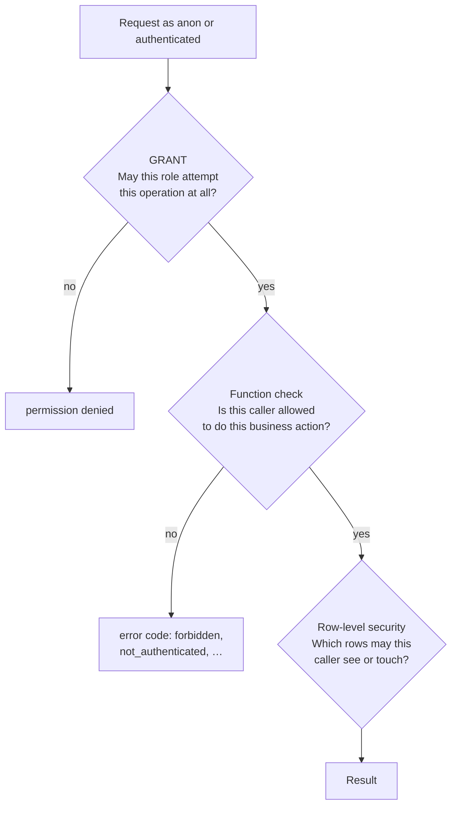

# Access control

Who can reach what, and how that is enforced. The short version: every request
arrives at the database as one of two unprivileged roles, with the signed-in
user's identity attached; three independent layers then decide what it may do;
and no app holds a key that skips them.

Source: `supabase/migrations/20261121081400_access_control.sql` for grants and
policies, `…080100_identity.sql` for the role helpers, and the checks inside
each function. Tested by `supabase/tests/020_access.sql` and `070_api.sql`,
which run as real API roles with real claims.

## The roles a request can have

| Postgres role   | Who it is                                                                   | How a request gets it                                                     |
| --------------- | --------------------------------------------------------------------------- | ------------------------------------------------------------------------- |
| `anon`          | A visitor who is not signed in                                              | The publishable key alone                                                 |
| `authenticated` | Any signed-in person: shopper, seller, driver, warehouse associate or staff | The publishable key plus the user's session token                         |
| `service_role`  | Bypasses row-level security                                                 | A secret key. **No app has one.** Reserved for future server-side workers |

Everything a signed-in person is beyond "a shopper" comes from rows, not from
the token:

| They are…                       | Because of a row in…            | Checked by                                                            |
| ------------------------------- | ------------------------------- | --------------------------------------------------------------------- |
| Internal staff, with a role     | `staff_members` (`active`)      | `private.is_staff()`, `private.has_staff_role(…)`                     |
| A member of a seller account    | `seller_members`                | `private.is_seller_member(seller)`, `private.is_seller_admin(seller)` |
| A warehouse associate at a site | `warehouse_staff`               | `private.works_at(warehouse)`                                         |
| An active driver                | `drivers` (`status = 'active'`) | `private.my_driver_id()`, `private.drives_route(route)`               |

Because these are looked up on every request, removing the row removes the
access immediately. A token that is still valid for an hour does not keep a
dismissed employee in the console.

**Staff and a second factor.** `private.staff_session_ok()` is part of every
staff check. When the setting `require_staff_mfa` is true, it requires the
session token's `aal` claim to be `aal2` — that is, the person completed
multi-factor sign-in for this session. With the setting on, a staff member who
signed in with a password alone has exactly a shopper's access. The setting
ships as `false` and must be turned on before launch.

## Three layers



### 1. Grants: least privilege, stated explicitly

The migrations start by revoking everything from `anon` and `authenticated` —
tables, sequences, functions — and from `public` on functions, and they switch
off the default privileges that would grant new objects automatically. Nothing
is reachable until a later statement grants it on purpose.

What is then granted:

- **Functions.** `EXECUTE` on a named list. Visitors get the browsing
  functions only. Signed-in users get the rest; each of those checks its caller.
- **Tables, read.** `SELECT` where a policy can sensibly scope it.
- **Tables, write.** Rare, and by column. A shopper may update four columns of
  their own profile, not `phone_verified_at`. A seller may write listing
  content columns of `products`, not the ranking and summary columns. Orders,
  payments, shipments, stock, ledger, routes and stops have **no** write grant
  at all: they change only inside functions.

Supabase's own guidance is the same two-layer model — grants decide whether a
role can touch an object, policies decide which rows — and the platform is
moving its defaults toward revoking automatic grants. The migrations do not
depend on which default a project has: they revoke first either way.

### 2. Function checks

A `security definer` function runs with its owner's rights, so row-level
security does not constrain it; the function is responsible for checking the
caller. Every one of them does, in its first lines, and refuses with a stable
error code (`not_authenticated`, `forbidden`, or a "not found" that does not
reveal whether the thing exists).

Read functions run with the **caller's** rights (`security invoker`) wherever
the caller's own row access is exactly what the screen should show —
`search_products`, `get_product`, `my_orders`, `list_categories`. Those cannot
return more than the policies allow, whatever the function body says.

### 3. Row-level security

Enabled on every table in `public` and `private`. A table with no matching
policy returns nothing.

Policy style, which matters for both correctness and speed:

- Role checks are wrapped in a sub-select — `(select private.is_staff())` — so
  Postgres evaluates them once per statement, not once per row.
- Checks that need another table go through the `security definer` helpers in
  `private`, so a policy on table A can consult table B without recursing into
  B's own policies.
- In a sub-query inside a policy, **every reference to the outer table's column
  is qualified with the table name.** The reason is the bug described
  [below](#a-real-bug-and-what-it-taught).

## What each kind of user can do

A summary; the migration is authoritative.

### Visitor (`anon`)

| Can                                                                           | Cannot                                                                        |
| ----------------------------------------------------------------------------- | ----------------------------------------------------------------------------- |
| Search and browse active products from active sellers; read published reviews | See drafts, rejected listings, or anything from a pending or suspended seller |
| Read categories, districts, zones, holidays, the fee schedule                 | Read any profile, address, order, stock level or seller's private details     |
| Get a delivery estimate and a checkout quote                                  | Place an order                                                                |
| Report a listing, review or seller, giving an e-mail address                  | Read the report queue                                                         |

### Shopper (any signed-in user)

| Can                                                                                   | Cannot                                                                                    |
| ------------------------------------------------------------------------------------- | ----------------------------------------------------------------------------------------- |
| Read and edit their own profile (name, phone, locale, marketing choice)               | Mark their own phone as verified                                                          |
| Add, edit and soft-delete their own addresses                                         | See anyone else's                                                                         |
| Place, pay (in sandbox), cancel and read their own orders, including the delivery PIN | Read another person's order — it answers "not found", the same as one that does not exist |
| Review a product they received; request a return; file a complaint                    | Review something they did not buy, or twice                                               |
| Record and withdraw their own consents                                                |                                                                                           |

### Seller member

| Can                                                                                                                 | Cannot                                                                                                                  |
| ------------------------------------------------------------------------------------------------------------------- | ----------------------------------------------------------------------------------------------------------------------- |
| Read their seller's private details, members, listings, offers, stock, statements and payouts                       | Read another seller's                                                                                                   |
| Create listings as draft or pending review; edit their content; set price, handling time and status of their offers | Publish a listing; write ranking, rating or summary columns                                                             |
| See the order lines they sold and each line's progress, with the shopper's first name, district and cantón          | See the shopper's full name, phone, e-mail, address or map pin — Yuntera delivers, so the seller never needs them       |
| Set stock at their own location; announce stock sent to a warehouse; mark their own parcels packed                  | Change stock held in a Yuntera warehouse                                                                                |
| Reply to a review of their product                                                                                  | Remove or edit a review                                                                                                 |
| Admins and owners: edit the shop front, manage members, request a change of payout account (finance approves it)    | Change the payout account or contact phone and e-mail; read an account number in full; create, alter or remove an owner |

### Warehouse associate

| Can                                                                                                   | Cannot                                                      |
| ----------------------------------------------------------------------------------------------------- | ----------------------------------------------------------- |
| At the sites they are assigned to: see the floor board, pick lists, bins, stock and inbound shipments | See other sites                                             |
| Receive, put away, pick, pack, adjust stock with a note                                               | See shoppers' addresses or phones, prices paid, or payments |

### Driver

| Can                                                                                                                         | Cannot                                                                                  |
| --------------------------------------------------------------------------------------------------------------------------- | --------------------------------------------------------------------------------------- |
| See routes assigned to them and, for each stop: recipient name, phone, _señas_, pin location, parcels, cash to collect      | See the delivery PIN, the order's contents or price, or any other order of that shopper |
| Start a route, arrive, complete a stop with the shopper's PIN, record a failed attempt with a reason, report their position | Read a route's stops more than 24 hours after it was completed                          |
| See their own cash settlements                                                                                              | See another driver's route or position                                                  |

### Staff

Admin implies every role below.

| Role      | Reach                                                                                                                                                                     |
| --------- | ------------------------------------------------------------------------------------------------------------------------------------------------------------------------- |
| `ops`     | Orders, sellers' private details, drivers, warehouses and staff assignments, zones and calendar, dispatch board, routes, settlements, returns; approve or suspend sellers |
| `support` | Orders and timelines, profiles, addresses, consents, sellers' private details, stock levels, returns, complaints, content reports; cancel an order for a shopper          |
| `finance` | Orders, fee schedule, seller statements, the ledger, settlements, invoices; decides sellers' bank-detail requests; previews, creates and settles payout runs              |
| `catalog` | Categories, brands, synonyms, all listings; approve or reject a listing; moderate reviews and content reports                                                             |
| `admin`   | All of the above, plus staff membership, settings, and the audit log                                                                                                      |

Sensitive changes by staff — to staff membership, seller status and private
details, drivers, warehouse assignments, settings, fees, payouts — are written
to `private.audit_log` with the acting user, and that log cannot be altered.
A bank account number is never copied into it: only its last four digits.

Two rules about people and money are enforced below the functions, on the
tables themselves. The platform always keeps one active administrator: a
trigger on `staff_members` refuses the change that would remove the last one.
And nobody writes a seller's payout account or a payout directly: sellers ask
with `seller_request_payout_details`, finance decides with
`ops_decide_payout_details`, and `payouts`, `payout_runs` and
`payout_detail_requests` have no grant to any API role at all. The full account
number is readable only through two finance functions (a request awaiting a
decision, and a run's transfer list). Finance confirms a change by calling the
shop's phone on file, so sellers cannot change that phone or the contact e-mail
directly either, and a request made within 30 days of a change to them is
flagged. Nobody in finance decides a request they made, or one for a shop they
belong to.

## Rules for `security definer` functions

These functions are the most powerful code in the system. The rules they follow:

1. **`set search_path = ''`**, and every object schema-qualified
   (`public.orders`, `private.fail`, `extensions.gen_random_bytes`). Without
   this, a caller who can create objects in any schema on the search path could
   plant a function or table with the same name and have it run with the
   owner's rights.
2. **Identify the caller from the token, never from an argument.** Functions
   use `(select auth.uid())`. No function accepts a user id to act as.
3. **Check before reading.** The permission check comes before any query whose
   result could leak through an error message or timing.
4. **Lock what you will change.** Rows that will be updated are selected
   `for update` first, in a consistent order, so concurrent calls cannot both
   pass a check and then both write.
5. **Fail with a code.** `private.fail('code')` raises SQLSTATE `P0001` with a
   stable message the client maps to text. Internal messages never reach a
   user.
6. **Granted explicitly.** `EXECUTE` is revoked from `public` and granted only
   to the role that should call it.

The `private` schema is not exposed by the API at all. `anon` and
`authenticated` have `USAGE` on it only so that policies and invoker-rights
functions can call the handful of helpers they are granted
(`is_staff`, `has_staff_role`, `is_seller_member`, `is_seller_admin`,
`my_seller_ids`, `my_driver_id`, `my_warehouse_ids`, `works_at`,
`drives_route`, `fold`, `like_escape`, `category_descendants`, `fail`).
Everything else in `private` — the audit log, the outbox, the functions that
capture payments and post to the ledger — is unreachable from outside.

## Checklist: adding a function safely

Before the migration is merged, answer each of these in the pull request.

- [ ] **Who may call it?** Name the role or relationship. If the answer is
      "anyone signed in", say what stops them acting on someone else's data.
- [ ] **Invoker or definer?** Use invoker rights if the caller's own row access
      is exactly what should be returned. Use definer only when the function
      must cross that boundary, and then:
  - [ ] `set search_path = ''` and schema-qualify everything.
  - [ ] First statement checks the caller and fails with a code.
  - [ ] No argument can name another user to act as.
- [ ] **What does it return to the wrong caller?** "Not found" for things that
      belong to someone else; never a different error that confirms existence.
- [ ] **Does it return personal data?** List the fields and why each is needed
      by this audience. A seller does not need a shopper's phone; a driver does
      not need the order's contents.
- [ ] **Does it write?** Lock rows first; make it safe to call twice.
- [ ] **Grant.** `grant execute … to authenticated` (or `anon, authenticated`
      for browsing). Nothing is callable without it.
- [ ] **Errors.** Every `private.fail('code')` has a message in
      `packages/db/src/errors.ts`. A unit test enforces this.
- [ ] **Client.** A method in `packages/db/src/api.ts` and a schema in
      `schemas.ts`.
- [ ] **Tests.** In `supabase/tests/070_api.sql`: one block proving the right
      caller gets the payload, and one proving each wrong caller is refused or
      gets nothing. In `contract.test.ts`: the response matches the schema.

Adding a table has a shorter list: enable row-level security (the
access-control migration does it for every table present when it runs — a
later migration must do it itself), grant the minimum, write a policy for each
operation granted, qualify outer columns, and add a block to
`020_access.sql`.

## A real bug, and what it taught

During testing, a driver signed in and saw an empty route: stops but no
parcels. The policy on `shipments` was meant to say "a driver sees the parcels
on stops they can see":

```sql
-- As first written. Wrong.
or exists (select 1 from public.route_stops rs where rs.shipment_id = id)
```

Inside the sub-query, the bare `id` does not mean `shipments.id`. Postgres
resolves an unqualified name against the innermost table first, and
`route_stops` has its own `id`. The condition was silently comparing a stop's
`shipment_id` to that same stop's `id` — never true. No error, no warning: the
policy simply matched nothing.

```sql
-- As it is now.
or exists (select 1 from public.route_stops rs where rs.shipment_id = shipments.id)
```

This one failed closed: the driver saw too little. The same mistake with the
logic the other way round would fail open and show too much, just as silently.

What changed as a result:

- Every policy sub-query was rewritten to qualify outer columns with the table
  name, and the rule is in the checklist above.
- The access tests gained **positive** cases. The suite had proved that a
  driver could not see other people's parcels; it had not proved that a driver
  could see their own. A test that only checks refusals passes when everything
  is refused.

The general lesson for this codebase: a row-level-security mistake does not
raise an error. The only defence is a test, per role, for both what must be
visible and what must not.

## What is not in place yet

- **Rate limiting.** Nothing limits sign-in attempts or function calls beyond
  the platform's defaults. The PIN check is the one place with its own counter.
- **Row-level security is enabled, not forced.** Table owners acting directly
  in the database are not subject to it. API roles are, which is what matters
  for requests; it means SQL run by an administrator in the dashboard sees
  everything.
- **Storage policies.** No buckets are defined, so no upload path exists.
- **Secret-key workers.** The first server-side worker (payment webhook, outbox)
  will hold a secret key. It should call narrowly scoped functions rather than
  write tables freely, and its key should be one created for it alone so it can
  be revoked independently.
- **Multi-factor enforcement is off** until `require_staff_mfa` is set to true.
- **Verified on local PostgreSQL only**, with a shim that copies Supabase's
  roles and permissive defaults. Re-run the access tests against the real
  project before trusting it with real data
  ([runbook](../07-deployment/runbook-first-deploy.md)).
