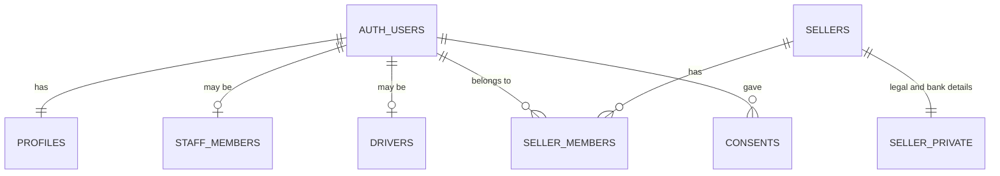
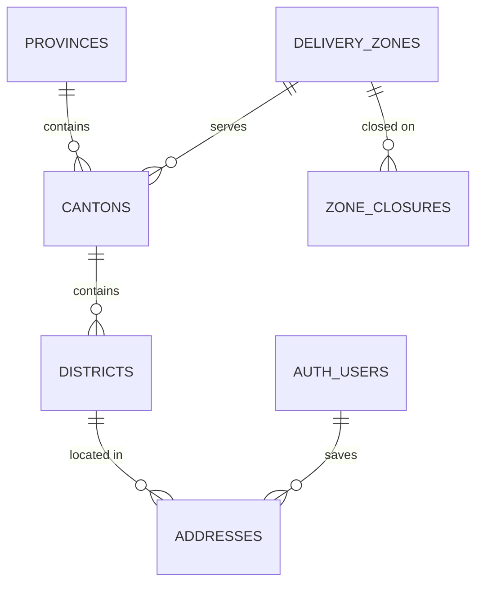
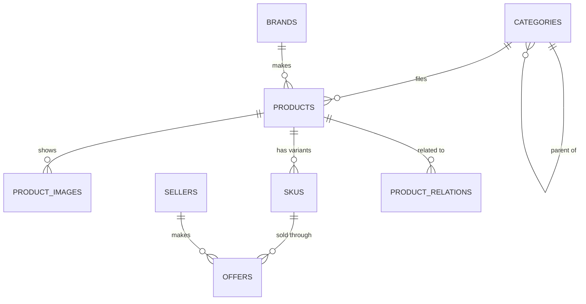
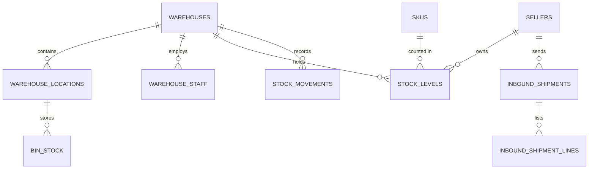
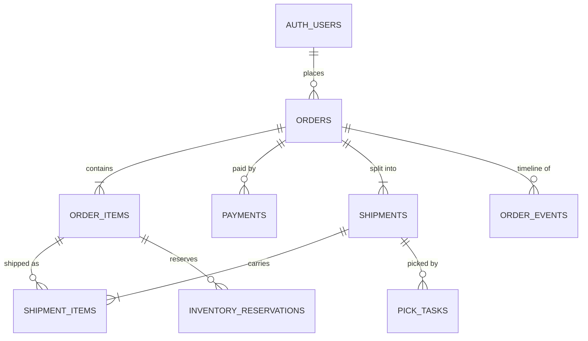
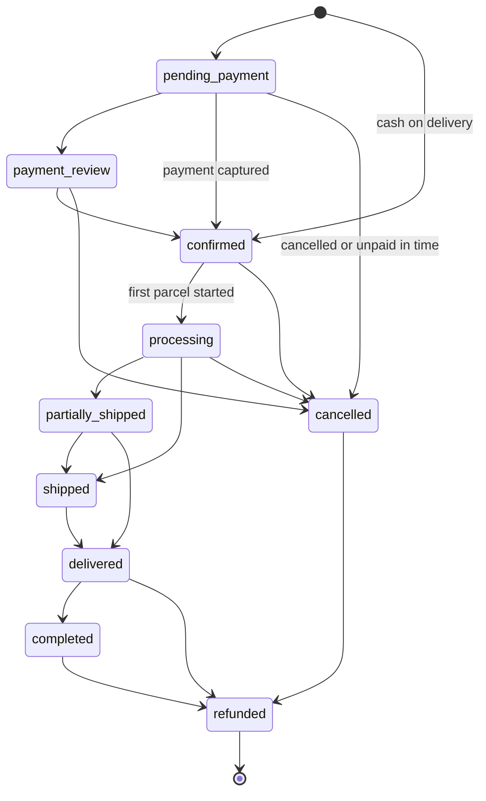
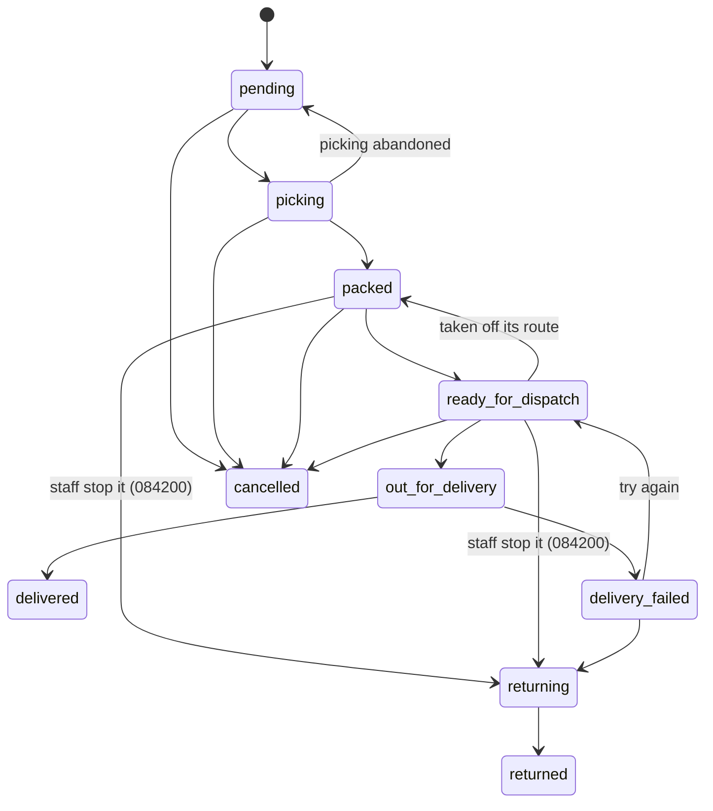
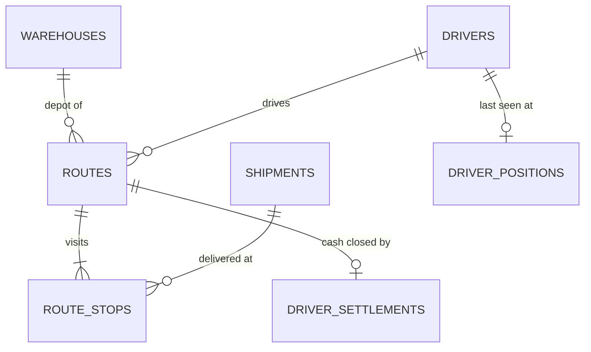
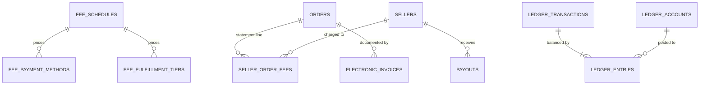
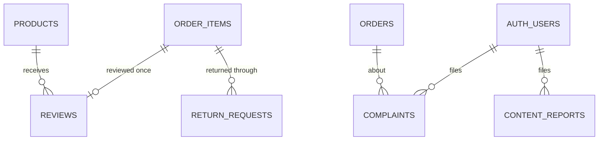

# Data model

The schema, one domain at a time: the tables that matter, how they relate, the
states things move through, and — most importantly — the rules the database
enforces so that no app, script or person can break them.

The source of truth is `supabase/migrations/`, applied in filename order. This
document describes those files as they are; where a table or column exists but
nothing maintains it yet, that is said.

**Conventions that hold everywhere**

- Money is a `bigint` count of céntimos in columns ending `_minor`. Rates are
  integer basis points (`_bps`).
- Prices are tax-inclusive; the IVA inside is derived.
- Every table has row-level security enabled. Who can read what is in
  [access control](access-control.md).
- `public` holds what the API can reach. `private` holds helpers, the audit
  log and the outbox, and is never exposed.
- Timestamps are `timestamptz`. Local dates are computed with a fixed UTC−6
  offset: Costa Rica has no daylight saving.

| Migration                                       | Domain                                                                                        |
| ----------------------------------------------- | --------------------------------------------------------------------------------------------- |
| `…080000_foundation`                            | Extensions, the `private` schema, enumerated types, shared helpers, `app_settings`            |
| `…080100_identity`                              | Profiles, staff, sellers, drivers, consents, role helpers                                     |
| `…080200_geography`, `…080300_geography_data`   | Provinces, cantones, districts, delivery zones, holidays, addresses, the delivery promise     |
| `…080400_catalog`, `…080450_catalog_reference`  | Categories, brands, products, SKUs, offers, search document, synonyms                         |
| `…080500_inventory`                             | Warehouses, locations, stock levels, bins, the stock ledger, inbound shipments                |
| `…080600_orders`                                | Orders, items, payments, shipments, reservations, pick tasks, events, outbox, lifecycle rules |
| `…080700_logistics`                             | Routes, stops, driver positions, cash settlements                                             |
| `…080800_finance`                               | Fee schedule, seller statements, ledger, payouts, electronic-invoice records                  |
| `…080900_trust`                                 | Reviews, returns, complaints, content reports, audit log                                      |
| `…081000_checkout` – `…081300_moderation`       | The functions that act on the above                                                           |
| `…081400_access_control`                        | Grants and policies                                                                           |
| `…081500_api_shopper`, `…081600_api_operations` | Screen-level functions                                                                        |

---

## Identity

One person signs in once and may hold several roles at the same time. Roles are
rows, not token claims, so revoking one takes effect on the next request.

| Table            | Holds                                                                                 | Notes                                                                                          |
| ---------------- | ------------------------------------------------------------------------------------- | ---------------------------------------------------------------------------------------------- |
| `profiles`       | Name, phone, locale, marketing opt-in                                                 | Created by trigger for every new account. Changing the phone clears `phone_verified_at`        |
| `staff_members`  | Role: `admin`, `ops`, `support`, `finance`, `catalog`; `active`                       | `admin` implies every role                                                                     |
| `sellers`        | Public shop-front: slug, trade name, status, cached score and health                  | Status: `pending` → `active` ↔ `suspended`, or `closed`                                        |
| `seller_private` | Legal name, identification, tax regime, contact, IBAN, SINPE Móvil number, KYC status | Split from `sellers` so the public can read a shop front with no path to legal or banking data |
| `seller_members` | Which users act for a seller: `owner`, `admin`, `staff`                               | Admins can never create, alter or remove an owner                                              |
| `drivers`        | Driver record: status, vehicle, capacity, licence and insurance expiry dates          | One per user                                                                                   |
| `consents`       | Purpose, policy version, granted and revoked times                                    | Append-only by design: withdrawing stamps `revoked_at`                                         |

**Enforced here**

| Rule                                                                 | Enforced by                                                                                     |
| -------------------------------------------------------------------- | ----------------------------------------------------------------------------------------------- |
| Phone numbers are Costa Rican, in E.164 form                         | `CHECK` on `profiles.phone`, `seller_private.contact_phone`, `drivers.phone`, `addresses.phone` |
| IBAN is `CR` plus 20 digits                                          | `CHECK` on `seller_private.payout_iban`                                                         |
| One seller per identification number                                 | `UNIQUE (id_type, id_number)`                                                                   |
| A new seller starts `pending` and sees nothing public until approved | Default status; `create_seller`                                                                 |
| Marketing consent is never on by default                             | `marketing_opt_in default false`                                                                |

`sellers.score` and `sellers.health` are a cache of the seller score defined in
`packages/core/src/sellers.ts`. **No job computes them yet**: every seller has
the default of 90 unless the seed or staff set otherwise.

---

## Geography

Costa Rica's territorial division is data: 7 provinces, 84 cantones and 494
districts in the dataset used (the research cites 492; see
[open questions](../08-open-questions.md)). A district's five-digit postal code
is province + cantón + district.

| Table            | Holds                                                                                                                                                                                                 |
| ---------------- | ----------------------------------------------------------------------------------------------------------------------------------------------------------------------------------------------------- |
| `delivery_zones` | Service level and price per zone: cutoff hour, processing and delivery weekdays, transit days, shipping fee, free-shipping threshold, whether cash on delivery is offered, whether the zone is active |
| `cantons`        | Each cantón and the zone it belongs to                                                                                                                                                                |
| `districts`      | Each district and its postal code                                                                                                                                                                     |
| `holidays`       | The operations calendar: days nothing is processed or delivered                                                                                                                                       |
| `zone_closures`  | A zone and a day with no capacity left                                                                                                                                                                |
| `addresses`      | A shopper's delivery address: district, _señas_, map pin, optional Plus Code                                                                                                                          |

Zones as seeded (amounts are assumptions; see
[pricing](../01-product/pricing-and-fees.md)):

| Zone           | Cantones | Cutoff | Transit           | Shipping | Free from | Active |
| -------------- | -------: | ------ | ----------------- | -------: | --------: | ------ |
| `gam-core`     |       16 | 14:00  | 1 delivery day    |   ₡1,500 |   ₡25,000 | Yes    |
| `gam-extended` |       15 | 12:00  | 1–2 delivery days |   ₡2,000 |   ₡35,000 | Yes    |
| `national`     |       53 | 12:00  | 2–5 delivery days |   ₡3,900 |     never | No     |

**Enforced here**

| Rule                                             | Enforced by                                                              |
| ------------------------------------------------ | ------------------------------------------------------------------------ |
| An address has a map pin inside Costa Rica       | `CHECK` on latitude 8.0–11.25 and longitude −86.0 to −82.5               |
| _Señas_ are detailed enough to be useful         | `CHECK` length 15–500                                                    |
| One default address per person                   | Partial unique index on `(user_id)` where default and not deleted        |
| Deleting an address never changes a past order   | Addresses are soft-deleted; orders copy the delivery details at purchase |
| An inactive zone can be shown but not ordered to | `place_order` refuses with `zone_not_served`                             |

---

## Catalogue

A **product** is one page in the store. A **SKU** is one buyable variant of it.
An **offer** is one seller's price and terms for one SKU. Several sellers can
make offers on the same SKU; the product page features one and lists the rest
([featured offer](../04-algorithms/featured-offer.md)).

| Table               | Holds                                                                                                | Notes                                                                             |
| ------------------- | ---------------------------------------------------------------------------------------------------- | --------------------------------------------------------------------------------- |
| `categories`        | Tree of categories with Spanish and English names, commission rate, default IVA rate                 | A null commission rate inherits from the parent, then from the schedule default   |
| `products`          | Title, description, bullet points, IVA rate, warranty months, made-in-Costa-Rica flag, status        | Also carries a search document and a listing summary, both maintained by triggers |
| `skus`              | Stock code, barcode, weight and dimensions                                                           | Dimensions drive the fulfilment fee tier                                          |
| `offers`            | Price, optional regular price, condition, fulfilment type, handling days, status, available quantity | `available_quantity` is maintained by trigger from stock                          |
| `search_synonyms`   | Local vocabulary: `refri` → `refrigeradora`                                                          | Curated by catalogue staff                                                        |
| `product_relations` | "Bought together" pairs with a score                                                                 | **Nothing writes to it yet**                                                      |

Product status: `draft` → `pending_review` → `active` or `rejected`; `archived`
at any time.

**Derived columns on `products`**

| Columns                                                                                                                              | Maintained by                                                     | State                                                                                   |
| ------------------------------------------------------------------------------------------------------------------------------------ | ----------------------------------------------------------------- | --------------------------------------------------------------------------------------- |
| `search_vector`, `title_folded`                                                                                                      | Trigger on product changes; generated column                      | Working                                                                                 |
| `min_price_minor`, `list_price_minor`, `featured_offer_id`, `offer_count`, `in_stock`, `fulfilled_by_platform`, `best_handling_days` | Triggers on offers, on stock, and on a seller's status            | Working                                                                                 |
| `rating_sum`, `rating_count`                                                                                                         | Trigger on reviews                                                | Working                                                                                 |
| `units_sold_30d`                                                                                                                     | `private.refresh_product_signals`, nightly where `pg_cron` exists | Working where scheduled                                                                 |
| `views_30d`, `price_index`, `return_rate`                                                                                            | —                                                                 | **Not maintained.** They hold neutral defaults (0, 1, 0) and so do not move ranking yet |

**Enforced here**

| Rule                                                         | Enforced by                                                                                         |
| ------------------------------------------------------------ | --------------------------------------------------------------------------------------------------- |
| A seller cannot publish their own listing                    | Triggers `products_guard_insert` and `products_guard_status`: only catalogue staff may set `active` |
| A struck-through regular price must be higher than the price | `CHECK (list_price_minor > price_minor)`                                                            |
| IVA rate is one of the legal rates                           | `CHECK` on `tax_rate_bps` in 0, 0.5%, 1%, 2%, 4%, 13%                                               |
| One offer per seller, SKU and condition                      | `UNIQUE (sku_id, seller_id, condition)`                                                             |
| Sellers cannot write ranking or summary columns              | Column-level grants: those columns are not in the `INSERT`/`UPDATE` grant                           |

---

## Inventory

Two views of the same stock. `stock_levels` is how many units a seller has at a
site and how many are promised to orders: availability is sold from this.
`bin_stock` is where inside a platform warehouse those units physically sit.

| Table                                         | Holds                                                                                                                                                                                                                                    |
| --------------------------------------------- | ---------------------------------------------------------------------------------------------------------------------------------------------------------------------------------------------------------------------------------------- |
| `warehouses`                                  | A platform warehouse, or a seller's own stock location (`kind`)                                                                                                                                                                          |
| `warehouse_staff`                             | Which users work at which site                                                                                                                                                                                                           |
| `warehouse_locations`                         | Bins: receiving, storage, pick, packing, staging, returns, damaged                                                                                                                                                                       |
| `stock_levels`                                | `on_hand` and `reserved` per warehouse, SKU and seller                                                                                                                                                                                   |
| `bin_stock`                                   | Quantity per bin, SKU and seller                                                                                                                                                                                                         |
| `stock_movements`                             | Append-only ledger of every change, with reason, reference and actor; a move between locations (084300) is one `transfer` row with both locations and no on-hand change, a count correction an `adjust` row with reference `cycle_count` |
| `inbound_shipments`, `inbound_shipment_lines` | Stock a seller announces, and what was actually received and damaged                                                                                                                                                                     |

Stock belongs to a seller even when it sits in a Yuntera warehouse: the key is
always warehouse + SKU + seller.

**Enforced here**

| Rule                                                                     | Enforced by                                                            |
| ------------------------------------------------------------------------ | ---------------------------------------------------------------------- |
| Stock is never negative                                                  | `CHECK (on_hand >= 0)`, `CHECK (quantity >= 0)`                        |
| More cannot be promised than exists — the rule that prevents overselling | `CONSTRAINT stock_reserved_within_on_hand CHECK (reserved <= on_hand)` |
| The movement ledger cannot be rewritten                                  | Trigger `stock_movements_immutable` rejects `UPDATE` and `DELETE`      |
| Removing stock that was never recorded is an error, not a silent no-op   | `private.apply_stock_change`                                           |
| A seller location belongs to a seller; a platform warehouse to none      | `CHECK ((kind = 'seller') = (seller_id is not null))`                  |
| An offer's available quantity follows stock                              | Triggers on `stock_levels` and `offers`                                |
| Stock changes only through functions                                     | No `INSERT`/`UPDATE` grant on stock tables to API roles                |

---

## Orders

An **order** is what the shopper bought and owes. It is split into
**shipments**, one per place the goods leave from. Stock is reserved the
instant the order is placed and consumed when the parcel is packed.

| Table                    | Holds                                                                                                                                                                          | Notes                                                                                     |
| ------------------------ | ------------------------------------------------------------------------------------------------------------------------------------------------------------------------------ | ----------------------------------------------------------------------------------------- |
| `orders`                 | Totals, payment method, zone, a copy of the delivery details, promise dates, delivery PIN, withdrawal deadline, warranty end, idempotency key                                  | Delivery details are copied so editing an address later cannot change where an order went |
| `order_items`            | What was bought: copies of title, variant, image, price, tax rate, weight and size                                                                                             | Copies, so the order reads the same forever                                               |
| `payments`               | Method, provider, status, amount, SINPE Móvil reference                                                                                                                        | No card data is stored here or anywhere                                                   |
| `shipments`              | Tracking code, origin, status, weight, attempt count; since 084200 `recalled_at`, `recalled_by` and `recall_reason` (5 to 300 characters) when staff stopped it before it left | One per origin warehouse per order                                                        |
| `inventory_reservations` | Units held for an order line: `active`, `consumed`, `released`                                                                                                                 |                                                                                           |
| `pick_tasks`             | One line to pick, with a suggested bin                                                                                                                                         | Created when a paid order is released to the warehouse                                    |
| `order_events`           | Timeline; rows flagged `visible_to_customer` are the tracking history                                                                                                          |                                                                                           |
| `private.outbox_events`  | Messages for work outside the transaction                                                                                                                                      | Written, not yet consumed                                                                 |

### Order lifecycle

Payment owns the first states; after that the order's status is derived from
its shipments (`private.sync_order_status`), one legal step at a time so the
timeline shows every stage. Since 084200 it never moves backwards: a
parcel can step back (planned again, then taken off a route), but the order
keeps the furthest status it reached until it ends.

### Shipment lifecycle

**Enforced here**

| Rule                                                   | Enforced by                                                                                                                                        |
| ------------------------------------------------------ | -------------------------------------------------------------------------------------------------------------------------------------------------- |
| Only the transitions above can happen                  | Triggers `orders_enforce_transition` and `shipments_enforce_transition`; the same tables in `packages/core/src/lifecycle.ts`, kept equal by a test |
| An order's total adds up                               | `CHECK (total_minor = items_total_minor + shipping_minor - discount_minor)`                                                                        |
| A line's total is price × quantity                     | `CHECK (line_total_minor = unit_price_minor * quantity)`                                                                                           |
| A retried checkout returns the same order              | `UNIQUE (user_id, idempotency_key)`                                                                                                                |
| A gateway notification cannot be applied twice         | Unique index on `(provider, provider_reference)`                                                                                                   |
| The delivery PIN is four digits                        | `CHECK` on `delivery_pin`                                                                                                                          |
| Colones only                                           | `CHECK (currency = 'CRC')`                                                                                                                         |
| The withdrawal deadline never shrinks                  | Set at purchase to 8 business days ahead; on delivery set to the later of that and 8 business days from delivery                                   |
| The legal warranty runs 30 business days from delivery | Set by `sync_order_status` when the order becomes `delivered`                                                                                      |
| Orders are created and changed only by functions       | API roles have `SELECT` only on these tables                                                                                                       |
| One delivery-fee refund per order                      | The refund register's reason `delivery_fee` (084200) with `UNIQUE (reason, source_id)`, the order as source                                        |

---

## Logistics

| Table                | Holds                                                                                                                                 | Notes                                                                      |
| -------------------- | ------------------------------------------------------------------------------------------------------------------------------------- | -------------------------------------------------------------------------- |
| `routes`             | Service date, depot, driver, status, planned distance and time                                                                        | Status: `draft` → `assigned` → `in_progress` → `completed`, or `cancelled` |
| `route_stops`        | Sequence, a copy of what is needed at the door (name, phone, _señas_, pin location, cash to collect), proof of delivery, PIN attempts | Stop status: `pending`, `arrived`, `delivered`, `failed`, `skipped`        |
| `driver_positions`   | The latest position per driver — one row each                                                                                         | No history is kept                                                         |
| `driver_settlements` | Cash expected against cash handed in at the end of a route                                                                            | `open` → `settled` or `short`                                              |

**Enforced here**

| Rule                                                               | Enforced by                                                                       |
| ------------------------------------------------------------------ | --------------------------------------------------------------------------------- |
| A route being driven has a driver                                  | `CHECK (status in ('draft','cancelled') or driver_id is not null)`                |
| A parcel is on only one route at a time                            | Partial unique index on `route_stops (shipment_id)` for pending and arrived stops |
| A driver never reads the orders table                              | No policy grants it; stops carry copies                                           |
| A stop's details close 24 hours after the route is completed       | The `route_stops` read policy                                                     |
| A delivery needs the shopper's PIN; five wrong tries lock the stop | `driver_complete_stop`                                                            |
| Cash collected must equal cash due                                 | `driver_complete_stop` returns `cod_amount_mismatch` otherwise                    |
| A cash difference must be explained in writing                     | `ops_settle_route` requires a note when handed ≠ expected                         |

---

## Finance

| Table                                                           | Holds                                                                                                                                                               | Notes                                                              |
| --------------------------------------------------------------- | ------------------------------------------------------------------------------------------------------------------------------------------------------------------- | ------------------------------------------------------------------ |
| `fee_schedules`, `fee_payment_methods`, `fee_fulfillment_tiers` | The published fee schedule, versioned                                                                                                                               | Readable by everyone; one schedule is active                       |
| `seller_order_fees`                                             | One row per seller per order: gross, each fee, tax on fees, payout                                                                                                  | Records the schedule version used                                  |
| `ledger_accounts`                                               | Chart of accounts: gateway clearing, driver cash, office cash, cash over/short, the revenue lines, IVA payable, refunds payable, and one payable account per seller |                                                                    |
| `ledger_transactions`, `ledger_entries`                         | Double-entry postings. Kinds: order capture, order refund, return refund, cash settlement, payout, adjustment                                                       | See [fees and settlement](../04-algorithms/fees-and-settlement.md) |
| `payouts`                                                       | A payment to a seller for a period                                                                                                                                  | The table exists; **no function creates payouts yet**              |
| `electronic_invoices`                                           | State of each fiscal document                                                                                                                                       | The table exists; **nothing issues invoices yet**                  |

**Enforced here**

| Rule                                        | Enforced by                                                              |
| ------------------------------------------- | ------------------------------------------------------------------------ |
| Every ledger transaction sums to zero       | Deferred constraint trigger `ledger_entries_balanced`, checked at commit |
| Ledger entries cannot be changed or removed | Trigger `ledger_entries_immutable`                                       |
| Exactly one fee schedule is active          | Partial unique index on `fee_schedules (active)`                         |
| An order's fees are computed once           | `UNIQUE (order_id, seller_id)`; capture is idempotent                    |
| A change of fees does not touch past orders | Statements store their own amounts and the schedule version              |

---

## Trust

| Table               | Holds                                                                                                                                              | Notes                                                                                        |
| ------------------- | -------------------------------------------------------------------------------------------------------------------------------------------------- | -------------------------------------------------------------------------------------------- |
| `reviews`           | Rating, text, status, the seller's reply                                                                                                           | Published immediately; moderation removes only what breaks content rules, never a low rating |
| `return_requests`   | Kind (`withdrawal`, `warranty`, `damaged`, `wrong_item`), quantity, reason, status, refund due date, amount refunded, who decided and who refunded | Status: `requested` → `approved` or `rejected`; `approved` → `refunded`                      |
| `complaints`        | The shopper's free complaint channel                                                                                                               |                                                                                              |
| `content_reports`   | Notice-and-action reports on a listing, review or seller, from anyone                                                                              |                                                                                              |
| `private.audit_log` | Who changed what on sensitive tables                                                                                                               | Immutable; read only through `audit_entries` by admins                                       |

**Enforced here**

| Rule                                                                                                                | Enforced by                                                             |
| ------------------------------------------------------------------------------------------------------------------- | ----------------------------------------------------------------------- |
| Only someone who bought the product reviews it, once per purchase line                                              | `UNIQUE (order_item_id)`; `submit_review` checks ownership and delivery |
| A withdrawal inside the window is approved automatically, with a refund due in 8 calendar days                      | `request_return`                                                        |
| Claims other than withdrawal need a delivered order and a reason                                                    | `request_return`                                                        |
| Returned quantity never exceeds what was bought                                                                     | `request_return`                                                        |
| The audit log cannot be rewritten                                                                                   | Trigger `audit_log_immutable`                                           |
| Changes to staff, sellers' status and private data, drivers, warehouse staff, settings, fees and payouts are logged | `audit_*` triggers                                                      |

---

## Settings

`app_settings` holds switches that must change without a deploy. It is readable
by everyone — nothing secret goes there — and writable only by admins.

| Key                   | Seeded value | Meaning                                                                                   |
| --------------------- | ------------ | ----------------------------------------------------------------------------------------- |
| `payments_mode`       | `sandbox`    | `sandbox` simulates payments; `live` is required in production and disables the simulator |
| `require_staff_mfa`   | `false`      | When true, staff permissions apply only to sessions with a second factor                  |
| `reservation_minutes` | `30`         | How long stock is held for an unpaid order                                                |
| `cod_max_order_minor` | ₡150,000     | Orders above this cannot be paid in cash on delivery                                      |
| `max_units_per_line`  | `10`         | Largest quantity of one offer in an order                                                 |
| `max_lines_per_order` | `40`         | Largest number of distinct offers in an order                                             |
| `order_number_prefix` | `YT`         | Prefix of order numbers and tracking codes                                                |

## What is not modelled yet

Carts are a cookie, not a table. There are no tables for promotions or
coupons, shopper–seller messages, wish lists, product questions, notification
preferences, or a search-query log. Storage buckets for images and proof of
delivery are not defined.
