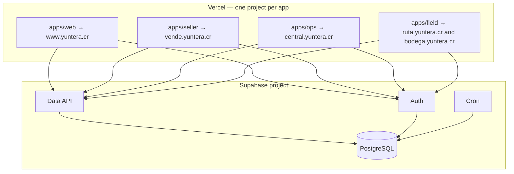

# Environments

Where Yuntera runs, what each environment is for, and the settings each one
needs. **Nothing described here exists yet.** No Supabase project, no Vercel
project and no domain has been created; this is the design the
[first-deploy runbook](runbook-first-deploy.md) builds.

## The first decision: where the database lives

This is the owner's decision and it is about money, so it comes first.

The owner's Supabase organisation is on a paid plan and already hosts the
production database of another product. A Yuntera project can go in that
organisation or in a new, separate one.

|                           | A. New project in the existing paid organisation                                                                                     | B. New, separate organisation on the free plan                                          |
| ------------------------- | ------------------------------------------------------------------------------------------------------------------------------------ | --------------------------------------------------------------------------------------- |
| Monthly cost              | About **US$10** more, for the project's compute, by Supabase's published pricing. The organisation's plan fee is already being paid  | **US$0**                                                                                |
| Pausing                   | Never paused                                                                                                                         | Free projects are paused after a period of inactivity and must be woken by hand         |
| Backups                   | Daily, kept 7 days                                                                                                                   | **None.** Supabase's documentation tells free-plan users to export their own            |
| Point-in-time recovery    | Available as an add-on: about US$100 a month for 7 days, and it requires a larger compute size                                       | Not available                                                                           |
| Billing and access        | Shared with the other product: one invoice, and anyone given organisation access can see both                                        | Fully separate                                                                          |
| Risk to the other product | A mistake in the wrong project touches a live business. Mitigated by naming, and by never giving automation organisation-wide rights | None                                                                                    |
| Moving later              | —                                                                                                                                    | A project can be transferred between organisations, or the database dumped and restored |

**Recommendation.** Use **B** for a preview with fake data: it costs nothing
and is isolated. Move to a paid project — in its own organisation if the
budget allows a second plan, otherwise option A — **before the first real
order**, because a marketplace holding real orders and real money owed to
sellers must have backups. This matches open question 49.

The prices above come from Supabase's documentation as read in November 2026;
check the current pricing page before deciding. Whichever is chosen, **do not
use or modify the existing production project of the other product**.

## Environments

| Environment    | Database                                                           | Apps                                                                             | Data                                                             | Purpose                                                                                                                |
| -------------- | ------------------------------------------------------------------ | -------------------------------------------------------------------------------- | ---------------------------------------------------------------- | ---------------------------------------------------------------------------------------------------------------------- |
| **Local**      | PostgreSQL 16 on the developer's machine, plus the stand-in API    | `pnpm dev`                                                                       | Seed data                                                        | Development and automated tests. See the [repository guide](../02-architecture/repository.md#run-it-locally-from-zero) |
| **Preview**    | One Supabase project, `payments_mode = sandbox`                    | Vercel preview and production deployments of each app, on Vercel's own addresses | Seed data: fictional sellers, products and orders; demo accounts | Showing the product; rehearsing the operation; the first test on the real platforms                                    |
| **Production** | A separate Supabase project on a paid plan, `payments_mode = live` | The same Vercel projects' production deployments, on the real domains            | Real                                                             | Real orders. Not to be created until the [go-live checklist](go-live-checklist.md) says so                             |

Two rules:

1. **Preview and production never share a database.** The seed creates
   accounts with a known password; it refuses to run unless the database is in
   sandbox mode, and production is never in sandbox mode.
2. **A database is created empty and built only from the migrations.** No
   table is ever created by hand in a dashboard.

A staging environment between preview and production is not planned. For a
solo founder a third environment is a third thing to keep in step; the preview
project plays that role until there is a team.

## What runs where

Each app is its own Vercel project with its own hostname. The internal
console is on a separate origin on purpose: browsers isolate cookies and
storage per origin, so a flaw in the public storefront cannot read the
console's session. Hostnames come from `packages/brand/src/brand.ts`.

The apps are stateless. All state is in the database, in cookies (cart,
delivery zone, session), and in Vercel's cache for catalogue pages.

## Settings per app

Every app needs the same three public settings. **None is secret.** The
publishable key identifies the project; every request is still checked by the
database's grants and row-level security.

| Variable                               | Value                                                  | Notes                                                                                                        |
| -------------------------------------- | ------------------------------------------------------ | ------------------------------------------------------------------------------------------------------------ |
| `NEXT_PUBLIC_SUPABASE_URL`             | The project's API address, `https://<ref>.supabase.co` | Also read at build time to write the Content-Security-Policy's `connect-src`, so changing it needs a rebuild |
| `NEXT_PUBLIC_SUPABASE_PUBLISHABLE_KEY` | The project's publishable key (`sb_publishable_…`)     | Not the legacy `anon` key, and never a secret key                                                            |
| `NEXT_PUBLIC_SITE_URL`                 | This app's own public address                          | Used for canonical links and sign-in redirects                                                               |

Set each for the Production and Preview environments in the Vercel project.
`apps/web/.env.example` documents them.

**There is no secret to configure in any app**, and there must not be. If a
future feature needs one — a payment gateway's private key, a secret key for a
worker — it belongs in a Supabase Edge Function's secrets, not in an app.

## Settings in the database

Changeable without a deploy, by an admin, in `app_settings`. The full list is
in the [data model](../03-data/data-model.md#settings).

| Key                                                           | Preview               | Production             |
| ------------------------------------------------------------- | --------------------- | ---------------------- |
| `payments_mode`                                               | `sandbox`             | `live`                 |
| `require_staff_mfa`                                           | `false` is acceptable | `true`                 |
| `reservation_minutes`, `cod_max_order_minor`, quantity limits | Seeded defaults       | Decided from the pilot |

Zones, fees, holidays and categories are also data.

## Region

Supabase projects are created in one region and cannot be moved without a
migration. Costa Rica has no Supabase or Vercel region.

**Recommendation: US East (North Virginia).** It is the large region that is
usually closest to Central America by network path, it has the fullest
feature availability, and Vercel's default function region for new projects
is in the same place — which matters more than the distance to Costa Rica,
because every page render makes several calls from Vercel to the database and
only one trip to the shopper.

This is reasoning, not measurement. Before creating the production project,
test latency from a Costa Rican connection to the candidate regions and pick
the lowest; then set the Vercel projects' function region to match the
database's.

Personal data will be stored in the United States under either choice. The
privacy notice already asks for consent to processing abroad; whether that is
sufficient is [open question 34](../08-open-questions.md).

## Secrets and who holds them

| Secret                                     | Exists today?              | Where it must live                                                                    |
| ------------------------------------------ | -------------------------- | ------------------------------------------------------------------------------------- |
| Database password                          | Created with the project   | The owner's password manager. Needed only to apply migrations from a laptop           |
| Supabase access token for the command line | When the owner creates one | The owner's machine; a CI secret if migrations are ever applied from CI               |
| Supabase secret key (`sb_secret_…`)        | Created with the project   | **Nowhere in this repository or in Vercel.** Unused until a server-side worker exists |
| Payment gateway keys                       | No                         | Edge Function secrets, when the integration is built                                  |
| SMTP credentials                           | No                         | Supabase Auth settings                                                                |
| Seed password for the preview              | Chosen when seeding        | The owner's password manager; shared only with people shown the demo                  |

Nothing secret is committed. `.gitignore` excludes every `.env*` file except
`.env.example`, and the local stand-in's signing key.

## Continuous integration and deployment

**Not set up.** `.github/workflows` is empty. The intended flow:

| On                       | Do                                                                                                                                             |
| ------------------------ | ---------------------------------------------------------------------------------------------------------------------------------------------- |
| Every pull request       | `pnpm ci`; start a PostgreSQL service, `pnpm db:local:reset`, `pnpm db:local:test`; contract tests; Vercel builds a preview deployment per app |
| Merge to the main branch | Vercel deploys each app to production                                                                                                          |
| A migration is merged    | Applied to the preview database first, then to production, by a person, following the [migrations policy](operations.md#migrations-policy)     |

Database migrations are deliberately not automatic at this stage: an
irreversible change to a database holding real orders should have a human
looking at it.
